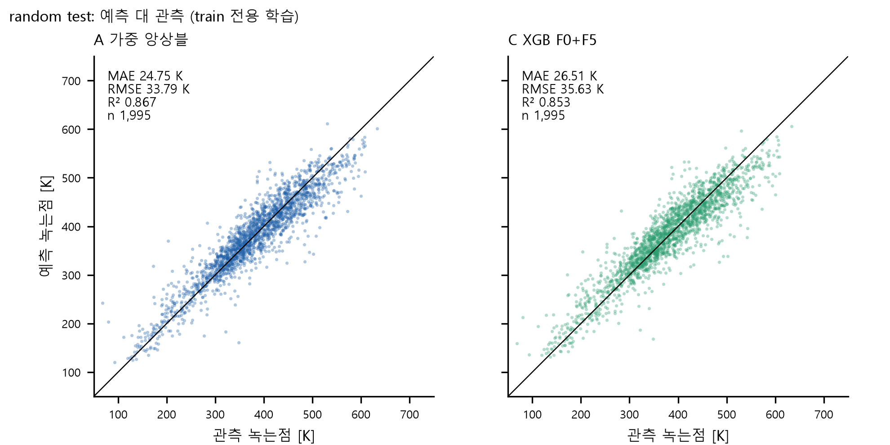
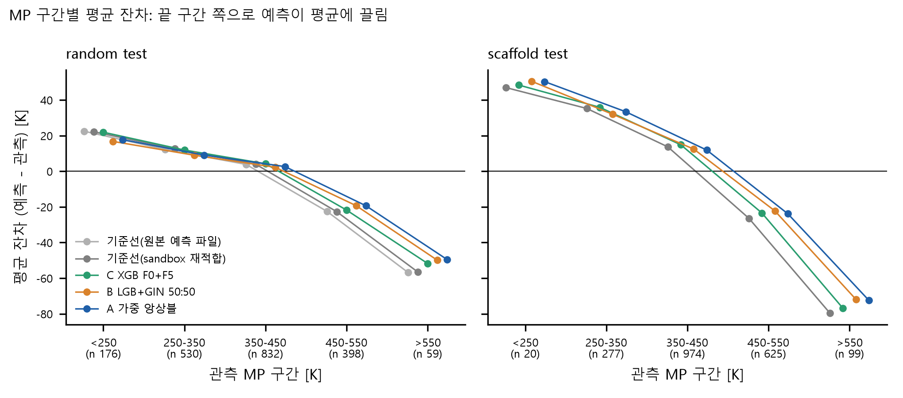
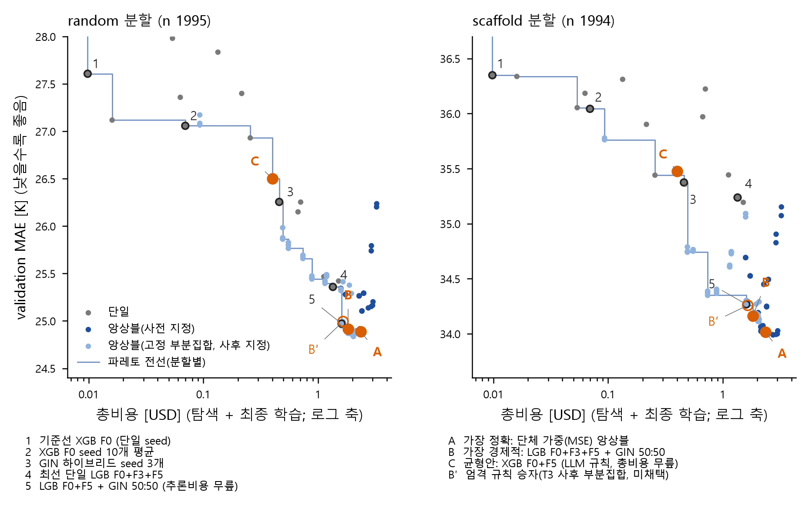
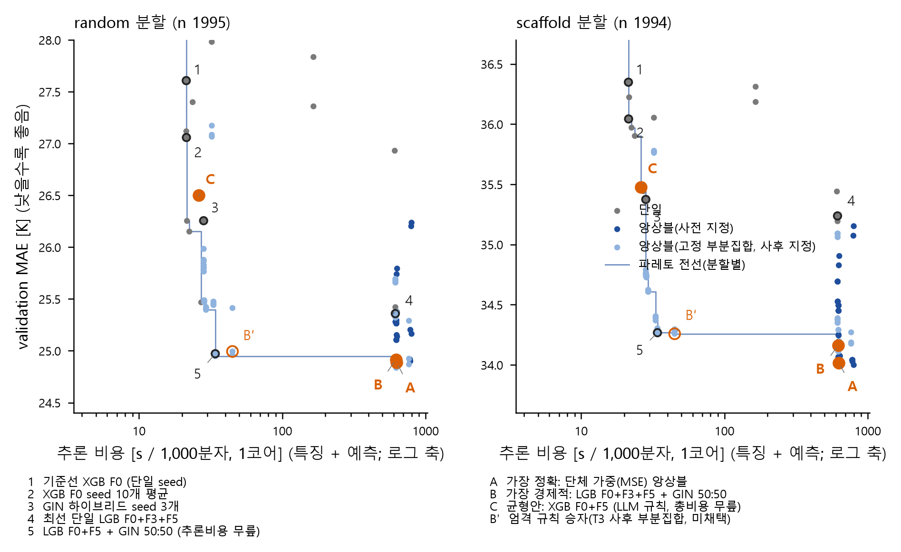
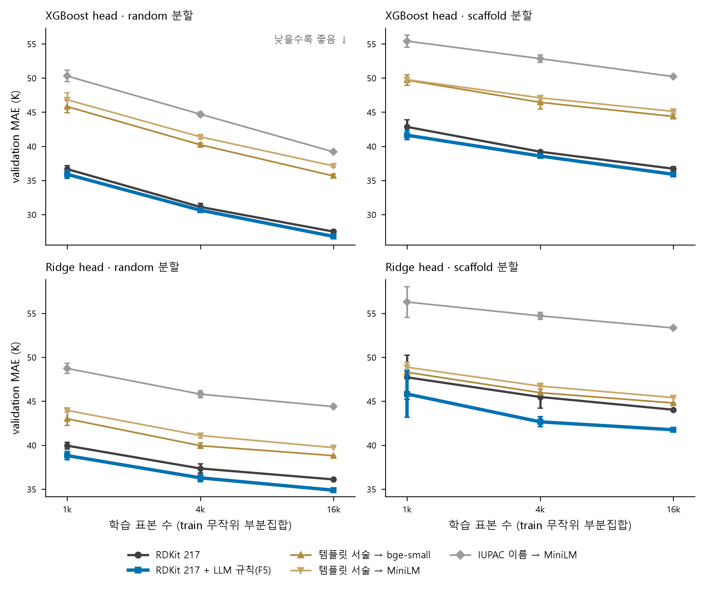
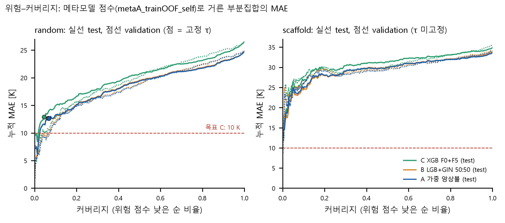

# 녹는점(mp) 예측 MAE 개선 — 최종 보고

작성 2026-11-22. 데이터: Bradley Open MP(`mp.csv`, 19,945분자, 68–790 K). 고정 분할 random(train 15,955 / validation 1,995 / test 1,995)과 scaffold(15,956 / 1,994 / 1,995). 단위는 모두 K이다. Δ는 MAE(새 모델) − MAE(기준)이며 음수가 개선이다. CI는 짝지은 부트스트랩 2,000회의 95 % 구간이다. 중복 제거 test는 train ∪ validation과 InChIKey 첫 블록이 겹치는 행을 뺀 것이다(random n 1,896, scaffold n 1,984).

## 결론 3줄

1. **목표 A 달성.** 가장 정확한 후보 A(가중 앙상블)는 random test MAE 24.750 K(n 1,995)이다. 원본 기준 예측 27.500 K 대비 −2.75 [−3.29, −2.25] K이다(중복 제거 n 1,896: −2.75 [−3.32, −2.22]). 단순한 B(LGB + GIN 50:50)도 24.755 K로 A와 구분되지 않는다(A−B −0.01 [−0.13, +0.12]).
2. **scaffold(목표 B)에서도 유의하게 좋아졌지만 수준은 여전히 높다.** A 33.649 K, sandbox 재적합 기준선 35.852 K 대비 −2.20 [−2.79, −1.61] K이다(n 1,995). 전체 test MAE 10 K(목표 C)는 어느 방식으로도 근처에 가지 못했다. validation에서 고정한 신뢰도 기준으로 거른 상위 6.8 %도 test MAE 12.64 K였다.
3. **LLM은 '규칙 설계자'로 쓸 때만 도움이 되었다.** LLM이 제안한 구조 규칙을 RDKit 코드로 구현한 F5 특징은 두 분할 모두에서 유의한 이득을 냈다. 반면 자연어 서술 임베딩, LLM 서술, few-shot 예측은 기술자 모델보다 나빴다. 비용 효율 측면에서는 XGB + F5 단일 모델(C)이 재학습 0.095 core-h, 추론 26 s/1,000분자로 기준선 대비 −0.99 K를 얻는다.

## 1. 목표별 달성 여부

| 목표 | 판정 | 근거 (test, train 전용 학습, 1회 평가) |
|---|---|---|
| A. random test에서 기준선을 유의하게 이김 | **달성** | A 24.750, B 24.755, C 26.509 K vs 원본 27.500 K. 세 후보 모두 CI가 0을 넘지 않음. 중복 제거 test에서도 같음 |
| B. scaffold 결과 보고 | **보고·개선** | A 33.649, B 33.987, C 34.924 K vs sandbox 기준선 35.852 K. 세 후보 모두 유의 |
| C. 10 K 도전(위험–커버리지) | **미달** | random: validation 고정 τ에서 커버리지 6.8 %(136분자), MAE 12.64 [10.75, 14.77] K. scaffold: validation에서 10 K를 만족하는 커버리지가 없어 τ를 고정하지 못함(사전 예측대로 미달) |
| D. 비용 효율 | **달성(정의 일부 단서)** | 프로젝트 전체 83.38 core-h, 0.174 kWh, LLM API 2.10 USD. 예산은 90 core-h / 15 USD. '가장 경제적' 후보 B는 random에서 A와 구분되지 않지만, scaffold test에서는 A가 B보다 0.34 [0.06, 0.62] K 좋았다 |

### 1.1 test 주 결과

| 후보 | random MAE / RMSE / R² (n 1,995) | 중복 제거 (n 1,896) | 원본 기준 대비 Δ [CI] | scaffold MAE / R² (n 1,995) | 중복 제거 (n 1,984) | sandbox 기준선 대비 Δ [CI] |
|---|---|---|---|---|---|---|
| A 가중 앙상블 | 24.750 / 33.786 / 0.867 | 25.045 | −2.75 [−3.29, −2.25] | 33.649 / 0.636 | 33.627 | −2.20 [−2.79, −1.61] |
| B LGB F0+F3+F5 + GIN 50:50 | 24.755 / 33.847 / 0.867 | 24.991 | −2.74 [−3.32, −2.22] | 33.987 / 0.629 | 33.975 | −1.86 [−2.52, −1.24] |
| C XGB F0+F5(LLM 규칙) | 26.509 / 35.627 / 0.853 | 26.841 | −0.99 [−1.42, −0.57] | 34.924 / 0.612 | 34.896 | −0.93 [−1.46, −0.41] |
| 원본 예측 파일(수업 기준선) | 27.500 / 36.877 / 0.842 | 27.790 | 0 | – | – | – |
| sandbox 재적합 기준선(seed 42, n_jobs 8) | 27.633 / 36.950 / 0.841 | 27.940 | +0.13 | 35.852 / 0.597 | 35.826 | 0 |

- 후보의 seed: A·B의 GBDT·GIN 멤버는 seed 0, 1, 2 평균이고, A scaffold의 특허 멤버는 42, 43, 44 평균이다. C는 seed 42, 0, 1 평균이다. seed 조합별 MAE(평균 ± SD): random A 24.96 ± 0.25, B 25.08 ± 0.27, C 26.77 ± 0.17 K; scaffold A 33.86 ± 0.15, B 34.34 ± 0.19, C 35.28 ± 0.34 K.
- 두 기준 순위: random에서 A와 B의 순위가 전체 test(A 1위)와 중복 제거 test(B 1위) 사이에 바뀐다. 차이는 유의하지 않다. scaffold에서는 순위가 같다(A > B > C).
- validation 예상과 test 차이: random −0.16 ~ +0.01 K, scaffold −0.17 ~ −0.55 K. 후보 선택의 낙관 편향은 작았다.
- 참고(사전 지정 후보가 아님, 선택에 쓰지 않음): A의 멤버로 함께 만든 LGB F0+F5 단일의 random test MAE는 25.634 K였다. scaffold의 특허 데이터 추가 XGB는 34.098 K였다.
- 기준선 재현 문제(1단계): sandbox에서 같은 설정을 다시 적합하면 스레드 수에 따라 random test 27.40–27.77 K로 흔들린다. 그래서 목표 A의 기준은 원본 예측 파일(27.4995 K)로 정했다. A·B는 이 범위 전체보다 2.6 K 이상 낮다.

### 1.2 보조 결과: train + validation 재학습

명세 규칙(나무 수 = best_iter × n_fit / n_inner, 가중치 고정)으로 재학습한 test 결과다. 주 결과는 원 기준선과 같은 train 전용 학습이고, 이것은 배포용 참고값이다.

| 후보 | random test | scaffold test |
|---|---|---|
| A (모든 멤버 재학습) | 24.482 | 32.503 |
| B | 24.437 (LGB만 재학습) | 32.582 (전부 재학습) |
| C | 26.191 | 33.930 |

random 이득은 −0.23 ~ −0.37 K이고, GIN까지 바꾼 변형은 CI가 0에 걸쳤다. scaffold 이득은 −0.78 ~ −1.41 K로 유의했다. 새 scaffold의 화학 공간을 더 보는 것이 scaffold 분할에서 특히 중요하다는 뜻이다.

### 1.3 MP 구간별 오차 — 평균으로 끌리는 경향은 남아 있다

| 구간(관측, random test) | n | A MAE | A 평균 잔차 | 원본 기준선 MAE | 원본 평균 잔차 |
|---|---|---|---|---|---|
| < 250 K | 176 | 25.6 | +17.7 | 30.5 | +22.5 |
| 250–350 | 530 | 21.1 | +9.1 | 24.3 | +12.3 |
| 350–450 | 832 | 23.0 | +2.6 | 24.9 | +3.9 |
| 450–550 | 398 | 29.1 | −19.4 | 31.5 | −22.5 |
| > 550 K | 59 | 49.7 | −49.5 | 57.1 | −56.9 |

scaffold의 > 550 K(n 99)는 A 74.6 K(평균 잔차 −72.5)로, 기준선 80.9 K(−79.7)보다 조금 줄었을 뿐이다. 끝 구간의 '평균 쪽으로 끌림'은 1단계 진단 그대로 가장 큰 남은 오차원이다. 재보정(선형·isotonic)으로는 줄지 않았다(validation 교차 적합; 선형 n.s., isotonic 악화).

## 2. 추천 세 가지

| 역할 | 후보 | 구성 | test MAE random / scaffold | 총비용(탐색 + 최종 재학습, 상한) | 최종 재학습(3단계 실측) | 추론 |
|---|---|---|---|---|---|---|
| **가장 정확** | A `wavg_mse|noO2` | 분할별 단체 가중 평균. random: h06 Yalkowsky 0.47, GIN 하이브리드 0.39, LGB F0+F5 0.12, XGB F0+F1+O3 0.02. scaffold: GIN 0.37, XGB+특허 1배 0.32, h06 0.31 | 24.750 / 33.649 | 33.77 + 6.22 = 39.99 core-h, 2.36 USD | 5.60 core-h | 626 s/1,000분자 |
| **가장 경제적(사전 정의)** | B `fixed_mean|best+GIN` | LGB F0+F3+F5와 GIN 하이브리드를 0.5 : 0.5로 단순 평균. 적합 모수 없음 | 24.755 / 33.987 | 24.58 + 4.97 = 29.55 core-h, 1.83 USD | 4.74 core-h | 622 s/1,000분자 |
| **균형안(실용)** | C `xgb600_F0F5_M2` | 기준선 XGB(600그루)에 LLM 규칙 특징 F5(101열) 추가 | 26.509 / 34.924 | 1.09 + 0.08 = 1.17 core-h + API 0.34 USD = 0.40 USD | 0.095 core-h | 26 s/1,000분자 |

- 총비용은 앙상블 트랙의 집계 규칙(탐색 블록 core-h + 최종 재학습 추정 core-h, USD는 클라우드 환산 + API)이다. 탐색 블록에 이미 들어 있는 학습 실행을 최종 모델로 본다면 재학습 항만큼 낮아지므로, 표의 값은 상한이다. 세 후보의 순서(C ≪ B < A)는 어느 쪽으로 세도 같다.
- **A를 고를 때:** 정확도가 최우선이고, GIN 학습(1스레드 CPU 약 30 s/epoch)과 3D 배좌 계산(F3)을 감당할 수 있을 때다. scaffold에서 B보다 유의하게 좋다.
- **B를 고를 때:** random 수준의 성능이면 충분하고, 가중치 적합 없이 단순한 구성이 좋을 때다. 지시서 7절의 정의('가장 정확한 후보와 통계적으로 구분되지 않는 후보 중 총비용이 가장 낮은 것', validation 기준)로 선정했다. test에서도 random은 구분되지 않았지만, scaffold는 0.34 K 뒤졌다.
- **C를 고를 때:** 대량 스크리닝처럼 추론 비용이 중요할 때다. 추론이 A·B보다 24배 빠르다(배좌 계산·GPU·LLM 호출 불필요). 기준선과 같은 코드에 F5 계산만 더하면 된다.
- 추론 비용 대부분(A·B의 약 588 s/1,000분자)은 F3의 ETKDG 배좌 생성이다. F3를 빼고 GIN을 남기는 변형(LGB F0+F5 + GIN 50:50)은 validation에서 B와 비슷했다(random 24.972, scaffold 34.267 K; 총비용 1.61 USD, 추론 34 s/1,000분자). 사후 지정 조합이라 test 후보로 쓰지 않았지만, 다음 단계의 1순위 후보다.

## 3. 효과가 있었던 것과 없었던 것 (validation, 기준선 XGB+F0 대비)

비용은 탐색과 최종 재학습을 합한 core-h다(ENS 트랙 집계, 상한). '유의'는 CI가 0을 넘지 않는다는 뜻이다. random n 1,995, scaffold n 1,994.

### 효과 있음

| 변경 | random Δ [CI] | scaffold Δ [CI] | 비용 | 비고 |
|---|---|---|---|---|
| 앙상블 A(4/3 멤버, 교차 적합 가중) | −2.72 [−3.19, −2.25] | −2.33 [−2.89, −1.78] | 39.99 core-h | 이득의 대부분은 GIN이 더하는 다른 오차(GBDT와 오차 상관 0.87–0.90) |
| LGB 튜닝 + F3 물리 특징 + F5 LLM 규칙 | −2.25 [−2.74, −1.77] | −1.11 [−1.71, −0.48] | 19.98 core-h | 최선 단일 |
| H06 Yalkowsky 구조(Tm = ΔHm/ΔSm) | −2.19 [−2.71, −1.68] | −1.15 [−1.80, −0.51] | 23.22 core-h | 전체 MAE는 F0F3F5와 같음. > 550 K 쏠림이 1.7 / 5.3 K 줄었지만 −62 ~ −69 K는 남음 |
| LGB 튜닝 + F5 | −2.14 [−2.60, −1.69] | −0.91 [−1.41, −0.37] | 15.52 core-h | 추론 27 s/1,000분자로 싸고 강함 |
| LightGBM Optuna 튜닝(F0만) | −1.46 [−1.83, −1.08] | −0.38 [−0.78, +0.04] | 13.29 core-h | scaffold n.s. |
| GIN + 기술자 하이브리드(seed 3 평균) | −1.35 [−2.07, −0.63] | −0.97 [−1.86, −0.12] | 9.11 core-h | 단일 seed는 XGB와 비슷 |
| **F5 LLM 규칙 특징(XGB, C)** | −1.11 [−1.50, −0.71] | −0.87 [−1.36, −0.37] | 1.17 core-h + 0.34 USD | 같은 head의 RDKit217 대비: random −0.70 [−1.06, −0.37], scaffold −0.85 [−1.25, −0.41] |
| F3 물리·결정 특징(대칭수, 유연성 τ, 수소결합, 평면성 등) | −0.68 [−1.07, −0.27] | −0.91 [−1.47, −0.35] | 5.09 core-h | scaffold에서 상대적으로 큼 |
| 특허 MP 데이터 1배 추가(scaffold 전용) | random은 악화(+0.32 ~ +2.19) | −1.01 [−1.56, −0.44] | 2.39 core-h | 양을 늘려도 −0.6 ~ −1.0 K에서 평평. random 악화로 본 학습 중단(사전 규칙) |
| seed 10개 배깅 | −0.55 [−0.81, −0.26] | −0.31 [−0.66, +0.05] | 1.38 core-h | 가장 싼 개선 |
| train + validation 재학습(test 보조) | −0.23 ~ −0.37 (test) | −0.78 ~ −1.41 (test) | 후보별 재학습 비용과 같음 | 배포용 |

### 효과 없음(또는 악화)

| 변경 | random Δ | scaffold Δ | 비고 |
|---|---|---|---|
| Morgan count 지문 + 입체 특징(F1 + O3) | −0.21 [−0.67, +0.24] | −0.45 [−1.02, +0.13] | n.s. |
| 손실 함수 L1·분위수(XGB) | 이득 없음 | 이득 없음 | T1 |
| 보조 물성 연쇄 특징(logS·logP·밀도·증기압·끓는점, 누설 차단) | n.s. | −0.39 [−0.83, +0.09] | logS와 mp 상관 r −0.21 ~ −0.23, 누설 없음 확인 |
| SMILES 표준화(O4), 반복측정 가중(H09) | n.s. | n.s. | |
| 극단 구간 가중(H19) | 전체 MAE 악화 | – | 채택 안 함(1 seed, 잠정) |
| 얼린 사전학습 임베딩 + RDKit217(MoLFormer, ChemBERTa-MLM) | +0.23 [−0.31, +0.75], +0.37 [−0.17, +0.91] | −0.04, −0.29 (n.s.) | 임베딩 단독은 +4.7 ~ +5.4 K. 0.92 core-h(임베딩) |
| Tanimoto kNN(O2) | +11.30 | +19.78 | 앙상블 기여 없음. 작은 이득은 근접 중복(n 73)에서만 |
| 재보정(선형·isotonic) | 선형 n.s., isotonic 악화 | 같음 | 평균 끌림은 재보정으로 안 고쳐짐 |
| 자연어 표현(T8 N1·N2·N3·M4) | 아래 4절 | | |

## 4. T8 — 자연어·LLM 데이터셋 결과 (사용자 관심 항목)

LLM을 네 가지 역할로 시험했다. 모든 비교는 validation이며, 같은 head(XGBoost 또는 Ridge)에서 RDKit 기술자 217개(F0)와 짝지어 비교했다.

| 역할 | 방식 | 결과 (XGBoost head, RDKit217 대비 validation Δ) | 판정 |
|---|---|---|---|
| 규칙 설계자 (M2) | LLM에 문헌 지식(분자 없음)과 train 200분자를 보여 녹는점 구조 규칙을 받고, RDKit 코드로 구현(F5, 101열) | random −0.70 [−1.06, −0.37], scaffold −0.85 [−1.25, −0.41] | **효과 있음.** 최종 후보 A·B·C 모두에 포함 |
| 템플릿 서술 → 문장 임베딩 (N2) | 구조 정보로 코드가 만든 서술 → MiniLM / bge-small | MiniLM +9.43 / +8.36, bge +8.04 / +7.65 K (random / scaffold) | 기술자보다 크게 나쁨 |
| IUPAC 이름 → 임베딩 (N1) | PubChem 이름 → MiniLM | +11.43 / +13.41 K | 가장 나쁨 |
| LLM 구조 서술 → 임베딩 (N3) | 구조만 쓰도록 지시한 LLM 서술(무작위 대표 표본) | N2보다 더 나쁨: N3 − N2 +3.72 [+2.39, +5.04] K(bge, random) | 효과 없음. 기억 효과 증거도 없음 |
| 대형 LLM few-shot (M4) | 최근접 이웃 k=20개를 예시로 준 예측(random validation 300분자) | 29.40 vs XGB 27.25 K(+2.15 [−1.15, +5.53]) | 구분 안 됨. 기억 누설 위험 때문에 최종 후보에서 제외 |
| zero-shot 회상 점검 | 이름·SMILES만 주고 녹는점 질문 | 유명 분자에서 ±5 K 적중 SMILES 29.0 %, 이름 36.5 % vs XGB 16 % | **LLM은 유명 분자의 녹는점을 일부 기억함** |
| 소형 언어모델 미세조정 (M3) | – | 사전 고정 규칙에 따라 건너뜀 | – |

해석:

- 녹는점에서 자연어 표현은 정보를 잃는다. 같은 분자를 문장으로 바꾸어 일반 문장 임베딩에 넣으면, 녹는점을 좌우하는 대칭·평면성·수소결합 같은 구조 정보가 흐려진다. 표본 수 곡선(1k → 16k)에서도 기술자와의 격차가 크게 줄지 않았다.
- LLM의 화학 지식은 코드로 바꿔 넣을 때 쓸모가 있었다. F5 규칙은 분자별 LLM 호출이 없는 고정 RDKit 코드다. 그래서 추론 비용이 0이고 기억 누설 경로가 없다. 규칙을 만들 때 LLM에 보인 200분자는 모두 train이며, test와 겹침 0을 3단계에서 다시 확인했다.
- zero-shot 회상 신호는 실재한다. 따라서 LLM이 분자별 숫자를 직접 내는 방식(M4, zero-shot)은 test에서 '기억'과 '예측'을 구분할 수 없다. 최종 후보에서 뺀 이유다.
- T8 API 비용은 합계 2.10 USD다(1차 1.371, N3 대표 표본 0.726 USD). host.llm의 프레임당 토큰 한도(약 200만) 때문에 N3 전체 서술은 일부만 생성했다. 결론은 무작위 대표 표본에서 냈다.

## 5. 목표 C — 위험–커버리지

- 점수는 분자별 |오차|를 예측하는 LightGBM 메타모델이다. 입력은 멤버 예측의 표준편차, 최근접 train Tanimoto, 0.7 이상 이웃 수, 반복측정 수, 예측값, 분자 크기다. train OOF로 학습하고, MAE ≤ 10 K를 만족하는 최대 커버리지의 임계값 τ를 validation에서 고정했다.
- **random:** validation에서는 A가 τ 14.675에서 커버리지 7.2 %(144분자)일 때 MAE 9.98 K로 경계선이었다. test에 같은 τ를 적용하니 커버리지 6.8 %(136분자), MAE 12.64 [10.75, 14.77] K로 미달했다. test 곡선의 상위 5 / 10 / 20 % MAE는 11.70 / 13.16 / 15.02 K다.
- **scaffold:** validation에서 30분자 이상으로 MAE ≤ 10 K를 만족하는 구간이 없어 τ를 고정하지 않았다. test 상위 5 %도 24.2–26.3 K다.
- 사전 지정 부분집합(test, 후보 A)에서 MAE가 가장 낮은 것은 다음과 같다. 최근접 train 유사도 ≥ 0.9인 분자(n 183) 15.21 K, 정제판(Double Plus Good) 분자(n 322) 18.70 K, 측정 1개뿐인 분자(n 1,488) 25.52 K.
- 해석: 라벨 잡음 하한은 약 2 K이고(1단계), 정제판 분자에서도 18.7 K가 남는다. 따라서 10 K의 장애물은 라벨 품질이 아니라 표현과 데이터 양이다. 1단계 학습 곡선에서 데이터를 2배로 늘려도 random validation은 −1.7 K였다.

## 6. 누설 감사 (지시서 9절)

| 항목 | 판정 |
|---|---|
| i. 세트 간 InChIKey 겹침 | 조건부 통과. 고정 분할 자체에 첫 블록 겹침이 있다(test 행 random 99, scaffold 11). 이 행들은 중복 제거 목록과 행 단위로 일치하며, 모든 test 결과를 두 기준으로 보고했다. 특허 194,801분자와 LLM에 보인 200분자는 test와 겹침 0 |
| ii. 라벨 유래 특징 | 통과. test 행 표본에서 F0·F3·F5·F1·O3을 다시 계산하니 차이 0. 보조 물성 특징은 최종 후보에 없음 |
| iii. test 없이 결정 | 통과(단서 1건). 2단계 모든 ledger의 test 열이 비어 있음. 1단계 학습 곡선 진단 24행에만 test MAE가 있고, 어떤 선택에도 쓰이지 않음. test 예측 29개 파일의 sha256을 먼저 기록한 뒤 평가 스크립트를 한 번 실행 |
| iv. T8 기억 누설 | 통과. 최종 후보에 분자별 LLM 호출 없음 |
| v. 문헌 대비 | 통과. 최저 24.75 K(20 K 안전 규칙 미발동). 중복 제거 전후 차이(+0.24 ~ +0.33 K)가 기준선(+0.29 K)과 같은 크기. Bradley/Tetko 계열 문헌 범위(약 25–33 K)의 하단 |

상세: [leakage_audit.md](phase3/leakage_audit.md)

## 7. 비용 요약 (목표 D)

| 단계·트랙 | CPU core-h | 비고 |
|---|---|---|
| 1단계 진단 | 0.71 | ledger 기록분 |
| T1 트리 부스팅(Optuna 포함) | 21.38 | |
| T4·T5 특징·외부 데이터 | 13.07 | |
| T8 자연어·LLM(+ N3 대표 표본) | 12.89 | API 2.10 USD |
| T2 GIN | 6.46 | |
| T1b 결합 | 6.99 | |
| T3 사전학습 표현 | 5.22 | 임베딩 계산 0.92 core-h 포함 |
| 앙상블·선택적 예측 | 1.66 | |
| 3단계 test 평가(+ 보조 재학습 7.01) | 15.00 | |
| **합계** | **83.38** | 예산 90 core-h. 추정 전력 0.174 kWh(25 W 가정, 약 45원), 클라우드 환산 약 4.20 USD(0.0504 USD/vCPU-h) + API 2.10 USD = 약 6.3 USD(예산 15 USD) |

GPU는 쓰지 않았다(장비에 없음). 단가 가정: [cost_assumptions.md](cost_assumptions.md)

## 8. 한계와 단서

- **기준선 재현:** sandbox에서는 원본 예측을 정확히 재현하지 못했다. 스레드 수에 따라 27.40–27.77 K였고, 원인은 확인하지 못했다. 목표 A는 원본 예측 파일을 기준으로 판정했다(사용자 결정).
- **선택 편향:** A의 멤버·가중치는 validation 교차 적합으로 정했다. 후보 수가 많아 validation 값이 조금 낙관적일 수 있지만, test와의 차이는 0.2 K 이내(random)였다.
- **'가장 경제적' 정의:** 지시서 7절 정의를 글자 그대로 적용하면 T3 관찰을 본 뒤 만든 사후 조합(1.66 USD, scaffold에서 A 대비 CI 하한 −0.00)이 뽑혀서, 그 조합을 제외하고 B를 골랐다.
- **비용 집계:** 후보별 총비용은 탐색 블록과 최종 재학습을 더한 값으로, 일부 학습 실행이 두 번 세어졌을 수 있는 상한이다(2절 표에 두 항을 나눠 적음). 프로젝트 합계(7절)는 ledger 실행 기록을 한 번씩만 더한 값이다.
- **CheMeleon·Enamine 미실시:** CheMeleon은 chemprop 설치 승인이 만료되었고, Enamine은 ochem.eu의 SSL 인증서 오류 때문이다. 미세조정(M3)도 하지 않았다.
- **GIN:** 가중치를 저장하지 않아 test 단계에서 같은 seed로 다시 학습했다. validation 예측이 비트 단위로 같아 재현은 확인했다.
- **실행 환경:** sandbox에서 몇몇 셀(새 커널·프로세스 시작)이 수십 분씩 멈춰 중단 후 재시작했다. 결과 수치에는 영향이 없다.

## 9. 다음 단계

1. F3 배좌 계산 없이 LGB F0+F5 + GIN 50:50으로 test 1회 확인을 한다. validation에서는 B와 비슷한 성능(random 24.972, scaffold 34.267 K)에 추론 비용이 약 1/18이었다.
2. 끝 구간 쏠림을 줄인다. Yalkowsky ΔSm 항에 결정 패킹·대칭 정보(3D 대칭수, 결정 구조 데이터베이스 기반 특징)를 넣고, 분위수·분포 회귀로 꼬리 구간을 따로 다룬다.
3. scaffold 일반화: train+validation 재학습이 scaffold에서만 −0.8 ~ −1.4 K였다. 새 골격 데이터를 늘리는 것이 효과적이다. 특허 데이터는 scaffold에만 이득이었으므로, 골격 다양성 기준으로 골라 넣는 방식을 시험한다.
4. GPU가 생기면 CheMeleon(Mordred 사전학습 D-MPNN)과 그래프 모델 미세조정을 같은 규약으로 비교한다.
5. LLM은 계속 '규칙 설계자'로 쓴다. F5의 효과를 그룹별로 나누어 보고(대칭·유연성·수소결합 등), 오차가 큰 화학 계열에 대한 추가 규칙을 train만 보여 주고 받는다.

## 10. 파일

- 3단계 최종 평가: [phase3/README.md](phase3/README.md), [누설 감사](phase3/leakage_audit.md)
- 후보 명세: [final_candidates_spec.md](phase2/ENS_ensemble/final_candidates_spec.md); 앙상블 트랙: [README](phase2/ENS_ensemble/README.md)
- T8 자연어·LLM 상세: [README](phase2/T8_nlp/README.md)
- 사전 고정 규약: [PREREG.md](phase2/PREREG.md); 1단계 진단: [PHASE1_SUMMARY.md](phase1/PHASE1_SUMMARY.md)
- 트랙별 ledger·예측·스크립트: `phase2/<트랙>/`, `phase3/`. 25 MB를 넘는 임베딩 행렬 등은 폴더에 넣지 않았다(목록: `phase2/NOT_SAVED_large_files.md`).
