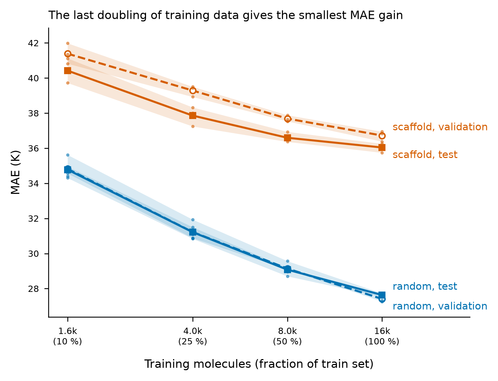
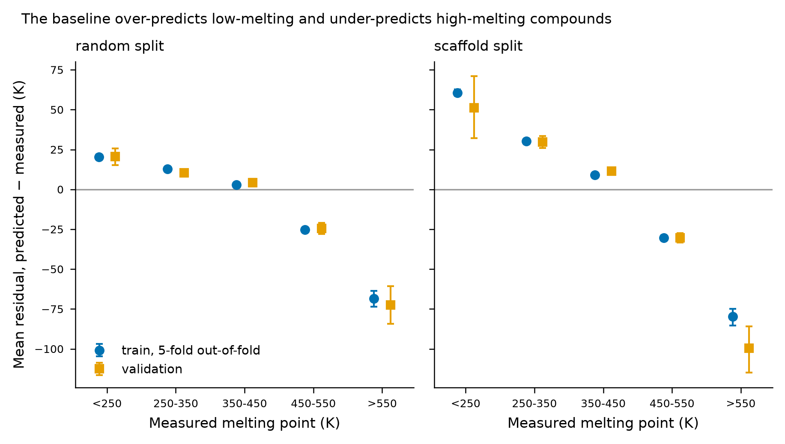
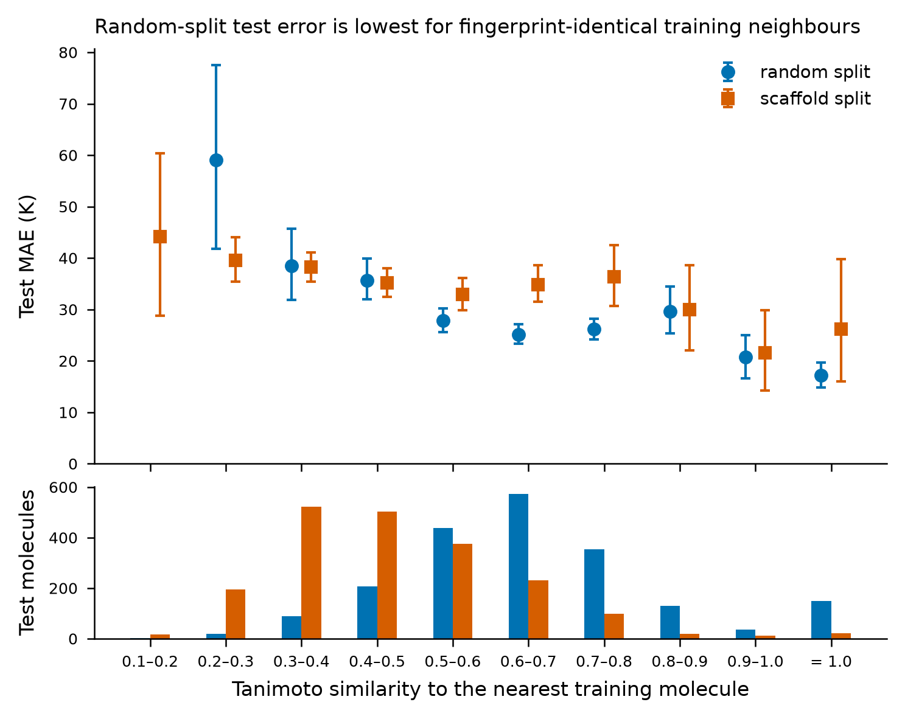

# 1단계 진단 요약 — mp(녹는점) 예측 오차 끌어내리기 (2026-11-20)

데이터: Bradley Open MP `mp.csv` 19,945행, 단위 K. 모든 수치는 고정 분할(seed 42) 기준이며, 괄호 안 n은 분자 수다. 기준선은 XGBoost(600그루, lr 0.05, depth 6, subsample 0.8, colsample 0.5) + RDKit 기술자 217개, train만 학습.

## 0. 한눈에

1. **기준선은 27.50 ± 0.1 K로 정확히 재현되지 않았다.** 샌드박스 재적합은 random test 27.63 K다. test 집합은 원본과 같고, XGBoost 적합이 스레드 수에 따라 달라지는 것이 유력한 원인이나 확정하지 못했다. 사용자 결정에 따라 목표 A의 기준은 원본 예측 파일(27.4995 K)로 고정했다.
2. **라벨 잡음은 주된 한계가 아니다.** 원본의 반복측정 산포로 본 test 라벨 잡음의 MAE 하한은 약 2 K(범위 1.3–3.5 K)이고, 라벨이 5 K 이내로 확인된 분자에서도 기준선 오차는 22 K다.
3. **데이터를 2배로 늘리면 random 1.4–2.2 K, scaffold 0.6–1.4 K 내려간다.** 기울기는 구간마다 줄고 있어, 가장 낙관적인 외삽으로도 30만 분자에서 random 18 K 수준이다.
4. **가장 큰 구조적 오차원은 대칭이 높은 분자다**(다른 계열을 보정한 뒤에도 +9.4 K). 고융점 과소예측(> 550 K에서 −68 K)은 눈금 문제가 아니라 정보 부족이어서 사후 재보정으로는 풀리지 않는다.
5. **전체 test MAE 10 K는 문헌에도 없고 이 진단으로도 기대하기 어렵다.** 현실적 목표는 이 데이터만으로 25–26.5 K, 외부 데이터를 더해 22–25 K이며, 10 K는 목표 C의 커버리지로 답한다.

## 1. 환경과 비용 측정

| 항목 | 값 |
|---|---|
| 실행 환경 | 기존 conda 환경 `mlstudy`의 인터프리터를 직접 실행 (Python 3.11.18, RDKit 2026.09.1, XGBoost 3.4.2, scikit-learn 1.9.1, torch 2.15.0+cpu) |
| 하드웨어 | Intel Core i5-1335U, 물리 10코어 / 논리 12스레드, RAM 15.7 GiB(가용 1.2 GiB), GPU 없음, 원격 컴퓨트 없음 |
| 기술자 217개 계산 (19,945분자) | wall 434 s, CPU 0.118 core-h, 최대 RAM 1.29 GB |
| 기준선 적합 1회 | wall 9.3–10.5 s, CPU 0.018–0.020 core-h, 최대 RAM 1.36 GB, 추론 0.008–0.009 s / 1,000분자 |
| 1단계 ledger 합계 (32건) | wall 1,023 s, CPU 0.712 core-h, 0.0015 kWh ≈ 0.38원, 클라우드 환산 0.036 USD |

비용 측정 도구는 `common/mpcommon.py`의 `CostMeter`(psutil)이고, 단가 가정은 [cost_assumptions.md](../cost_assumptions.md), 통합 ledger는 [ledger_phase1_all.csv](ledger_phase1_all.csv)다.

## 2. 고정 분할

| 분할 | 세트 | n | MP 중앙값 [K] | > 550 K | < 250 K | 사슬형 비율 |
|---|---|---|---|---|---|---|
| random | train | 15,955 | 380.65 | 393 | 1,417 | – |
| random | validate | 1,995 | 378.15 | 58 | 182 | – |
| random | test | 1,995 | 381.15 | 59 | 176 | – |
| scaffold | train | 15,956 | 368.15 | 326 | 1,721 | 0.193 |
| scaffold | validate | 1,994 | 426.33 | 85 | 34 | 0.000 |
| scaffold | test | 1,995 | 423.15 | 99 | 20 | 0.000 |

`train_xgb.split()` 그대로 만들었고 세트 간 행 겹침 0, 뼈대(3,840종) 걸침 0이다. 파일은 [random.csv](../splits/random.csv), [scaffold.csv](../splits/scaffold.csv)이며 열은 `row, smiles, inchikey, set, pos`다. `pos`는 원본 분할이 돌려준 세트 안 순서로, 이 순서로 읽어야 subsample이 있는 모델이 같은 수치를 낸다.

## 3. 기준선 재현

| 분할 | validation MAE [K] | test MAE [K] (95 % CI) | test RMSE [K] | test R² | 평균 예측기 MAE [K] |
|---|---|---|---|---|---|
| random (n_test 1,995) | 27.61 | 27.63 (26.50–28.74) | 36.95 | 0.841 | 73.19 |
| scaffold (n_test 1,995) | 36.35 | 35.85 (34.52–37.20) | 47.41 | 0.597 | 76.01 |

- 지시서의 기준값은 random 27.50 K / RMSE 36.88 K / R² 0.842다. 재현값은 +0.13 K 높아 허용 범위(± 0.1 K)를 벗어났다.
- test 1,995개는 원본 예측 파일과 순서·라벨까지 같다. 그러나 분자별 예측은 하나도 같지 않다(|차이| 중앙값 4.5 K, 최대 46.4 K, 상관 0.9954). 짝지은 부트스트랩으로는 재현 − 원본 = +0.133 K [−0.225, +0.471]로 구분되지 않는다.
- n_jobs 1–12를 모두 적합하면 서로 다른 적합이 8개 나오고(8–12는 동일) random test MAE는 평균 27.613 K, SD 0.127 K, 범위 27.402–27.773 K다. 원본 27.4995 K는 이 범위 안이지만, 원본 예측과 정확히 일치하는 설정은 없었다. 따라서 **원인은 미확정**이다(스레드 수 의존이 유력, 기술자 값 차이는 배제하지 못함). 표: [repro_check_thread_scan.csv](tables/repro_check_thread_scan.csv)
- 결정(사용자 확인): 목표 A의 짝지은 비교 기준은 원본 예측 파일(27.4995 K). 샌드박스 재적합 분포(평균 27.61 ± 0.13 K)는 보조 기준으로 함께 보고한다. 이후 XGBoost는 n_jobs=8로 고정하고, 스레드 수와 seed를 test 결과로 고르지 않는다.
- scaffold 전체 데이터 기준선 35.85 K는 대조할 원본 실행이 없는 새 수치다(원본 scaffold 결과는 5,000개 표본뿐).

## 4. 오차 분해

상세는 [errdecomp_summary.md](errdecomp_summary.md)에 있다. 오차 구조 분석은 test가 아니라 train 5-fold out-of-fold(OOF)와 validation으로 했다(지시서 대비 변경, 가설 설계에 test를 쓰지 않기 위함).

### 4.1 라벨 잡음 하한

Bradley 원본(figshare, 측정 28,645행, CC0)을 받아 직접 계산했다. donotuse 표지 377행과 SMILES 파싱 실패 301행(두 조건의 합집합 669행)을 빼면 27,976행 / 19,945종이고, `mp.csv`의 값은 찾은 19,944행 모두에서 원본 중앙값과 같다.

| 항목 | 값 |
|---|---|
| 반복측정이 있는 분자 | 4,679종 (측정 1개뿐인 분자 15,265) |
| 반복 범위 ≥ 10 K / ≥ 50 K | 442종 / 89종 (README는 410 / 86으로 적음 — 차이의 원인 미확인) |
| 반복 범위 중앙값 / 평균 | 1.0 K / 4.6 K |
| 같은 분자의 측정 쌍이 같은 값인 비율 | 29 % |
| 단일 측정 오차의 RMS | 7.2 K (출처가 다른 쌍) – 8.4 K (모든 쌍) |
| 단일 측정 오차의 평균 절대값 | 2.2–2.6 K (정규 가정), 가정 없는 범위 1.6–3.7 K |
| random test 라벨 잡음만의 MAE 하한 | 2.0–2.4 K (범위 1.4–3.4 K) |
| README 통계만으로 맞춘 모형(독립 추정) | 1.3–3.5 K, 반복의 75 %가 사본이라는 극단 가정에서 6.0 K |

라벨 품질 구간별 기준선 MAE (n_jobs=8 재적합):

| 라벨 품질 | random validation MAE [K] (n) | random test MAE [K] (n) | scaffold validation (n) | scaffold test (n) |
|---|---|---|---|---|
| 정제판(측정 ≥ 2, 범위 ≤ 5 K) | 22.04 (285) | 22.12 (322) | 34.14 (165) | 35.85 (122) |
| 측정 1개 | 28.50 (1,547) | 28.47 (1,488) | 36.70 (1,683) | 36.06 (1,750) |
| 전체 | 27.61 (1,995) | 27.63 (1,995) | 36.35 (1,994) | 35.85 (1,995) |

- 라벨이 5 K 이내로 확인된 분자에서도 오차가 22 K이므로, 현재 오차의 대부분은 라벨 잡음이 아니라 모델·표현의 한계다. 정제판 분자와 나머지의 차이(약 6 K)에는 분자 종류의 차이(무거운 원자 평균 12 대 17개)가 섞여 있다.
- 이 잡음 추정은 **하한**이다. 편집 데이터베이스의 반복값은 서로 옮겨 적은 것일 수 있고, 반복측정이 있는 분자는 작고 잘 알려진 화합물이다. 단일 항목의 큰 오류는 OOF 꼬리로 상한을 가늠할 수 있다: |오차| ≥ 100 K인 344개가 OOF MAE 27.80 K 중 2.89 K, ≥ 150 K인 86개가 1.00 K를 차지한다(전부가 라벨 오류는 아니다).
- 문헌의 "실험 불확도 약 35 °C"(Tetko 2016)는 서로 다른 특허 사이의 재현성이며, 이 데이터의 화합물 내 산포(RMS 7–8 K)와는 다른 양이다. 그 값을 이 데이터의 하한으로 그대로 쓰면 안 된다.
- 표: [label_noise_bradley_ranges.csv](tables/label_noise_bradley_ranges.csv), [label_noise_bradley_estimates.csv](tables/label_noise_bradley_estimates.csv), [baseline_mae_by_label_quality.csv](tables/baseline_mae_by_label_quality.csv), [label_noise_floor.csv](tables/label_noise_floor.csv). 행별 측정 수·범위·SD: [mp_replicate_stats.csv](tables/mp_replicate_stats.csv)

### 4.2 고정 test 학습 곡선

| 분할 | train 비율 | n_train | validation MAE 평균 ± SD [K] | test MAE 평균 ± SD [K] |
|---|---|---|---|---|
| random | 10 % | 1,596 | 34.82 ± 0.22 | 34.78 ± 0.73 |
| random | 25 % | 3,989 | 31.22 ± 0.32 | 31.21 ± 0.62 |
| random | 50 % | 7,978 | 29.14 ± 0.04 | 29.08 ± 0.44 |
| random | 100 % | 15,955 | 27.41 ± 0.19 | 27.63 ± 0.10 |
| scaffold | 10 % | 1,596 | 41.39 ± 0.58 | 40.42 ± 0.70 |
| scaffold | 25 % | 3,989 | 39.29 ± 0.31 | 37.86 ± 0.56 |
| scaffold | 50 % | 7,978 | 37.69 ± 0.18 | 36.59 ± 0.30 |
| scaffold | 100 % | 15,956 | 36.72 ± 0.30 | 36.04 ± 0.27 |

- 데이터 2배당 MAE 변화(마지막 2배, ± 표준오차): random validation −1.73 ± 0.11 K / test −1.44 ± 0.26 K, scaffold validation −0.97 ± 0.20 K / test −0.55 ± 0.23 K. 네 수준 전체 로그선형 적합은 random −2.24 / −2.17 K, scaffold −1.43 / −1.34 K.
- 기울기는 구간마다 줄어든다. validation 기준 외삽(낙관–보수): random 2배 25.2–26.0 K, 4배 22.9–24.9 K, 약 19배(30만 분자) 17.9–23.2 K. scaffold 2배 35.3–35.9 K, 4배 33.9–35.3 K, 약 19배 30.7–34.3 K.
- 한계: seed 3개, 600그루 고정 설정의 곡선이며 같은 분포에서 뽑은 부분집합이다. 외부 데이터는 화학 공간과 라벨 품질이 달라 같은 n에서도 효과가 작을 수 있다.

### 4.3 오차 구조 (OOF + validation)

- 평균 당김(random OOF, n 15,955): < 250 K 구간 +20.4 K [18.7, 22.0], 450–550 K −25.3 K, > 550 K −68.5 K [−73.6, −63.6] (n 393). validation도 같은 크기다.
- 같은 잔차를 **예측값** 구간으로 나누면 n ≥ 1,000인 구간에서 −2.3 ~ +1.1 K다. 즉 당김은 눈금이 틀어진 것이 아니라 특징이 고융점·저융점을 가려내지 못해 생기는 평균 회귀다. 사후 재보정의 기대 이득은 0에 가깝다.
- 계열별 추가 오차(다른 계열과 크기를 보정한 회귀 계수, random OOF): 2D 대칭 높음 +9.4 K [7.7, 11.2] (n 1,648; validation +10.5 K [6.2, 15.2]), 전하 있음(나이트로 제외) +10.1 K [5.1, 16.4] (n 130), 다환 +3.8 K, 강직 +2.9 K, 수소결합 주개 ≥ 3 +2.5 K. 사슬형·카복실산·아마이드·할로젠 다량은 CI가 0을 포함한다. 입체 미표기는 OOF +2.0 K였으나 validation에서 재현되지 않았다.
- OOF 상위 오차 50개 중 44개가 과소예측이다. 작고 수소결합 주개가 없는 분자에 400–500 K 라벨이 붙은 사례는 라벨 오류로 의심되나 외부 확인은 하지 않았다. 모델 예측을 쓰지 않는 규칙에 걸리는 분자는 random train에 26개, 전체 OOF MAE의 0.24 K다.
- 표: [resid_by_mp_bin.csv](tables/resid_by_mp_bin.csv), [mae_heavy_x_mp.csv](tables/mae_heavy_x_mp.csv), [mae_by_family.csv](tables/mae_by_family.csv), [family_adjusted_excess.csv](tables/family_adjusted_excess.csv), [top50_oof_errors.csv](tables/top50_oof_errors.csv)

### 4.4 근접 중복

- **9절 누설 감사 1번(세트 간 InChIKey 전체·첫 블록 겹침 0)은 주어진 분할에서 성립하지 않는다.** random test 1,995개 중 99개(InChIKey 전체 기준 8개), scaffold test 중 11개가 train 또는 validation과 첫 블록을 공유한다. 분할은 지시서대로 고정했으므로 test는 바꾸지 않고, 모든 최종 평가에 '중복 제거 test' 보조 지표를 함께 보고한다.
- 중복 제거 시 기준선: random 원본 27.50 → 27.79 K (+0.29 K [+0.09, +0.49], n 1,896), 재적합 27.63 → 27.94 K. scaffold 35.85 → 35.83 K (n 1,984).
- 기준선은 쌍둥이를 외우지 못한다: 첫 블록이 train에 있는 random test 92개에서 기준선 MAE는 20.9 K, train 쌍둥이의 라벨을 그대로 쓰면 11.4 K다.
- random test의 MAE는 최근접 유사도 0.2–0.3 구간 59.0 K(n 19)에서 1.0 구간 17.2 K(n 148)까지 내려간다. scaffold test는 0.3–0.8 구간에서 33–38 K로 평평하다.
- 표: [near_duplicates.csv](tables/near_duplicates.csv), [near_dup_effect.csv](tables/near_dup_effect.csv), [test_nn_similarity_mae.csv](tables/test_nn_similarity_mae.csv), 겹치는 test 행 [random](tables/overlap_test_rows_random.csv) · [scaffold](tables/overlap_test_rows_scaffold.csv)

## 5. 문헌

- 누설 없는 MP 예측 수준: 같은 Bradley 약 2만 분자에서 문헌 최고는 random test RMSE 35.4 °C(Austermeier 2025, 증강 GNN consensus). 23만 분자로 학습한 모델은 MAE 21.5–23 °C(Pu 2026, Huang 2025). 누설 없는 전체 test MAE 10 K는 확인한 문헌에 없다. 표: [literature_mp_table.md](literature/literature_mp_table.md) (9편)
- 지시서 2절의 인용 15건은 모두 원문과 일치했다. 단서: Tetko 2016의 32 °C는 50–250 °C 구간 값이고 전체는 35 °C다. Jablonka 2024는 회귀에서는 이점이 줄고 데이터가 많으면 기존 ML이 따라잡는다고 본문에 적었다. [literature_citation_check.md](literature/literature_citation_check.md)
- **T8(자연어·LLM)**: 1만 개 이상 회귀에서 대형 LLM이 GBDT·GNN을 이긴 사례를 찾지 못했다. 녹는점을 직접 다룬 LLM 결과는 두 건이고 둘 다 약하다(27.5만 분자 고/저 분류에서 미세조정 정확도 66–69 %, 이름만 주는 zero-shot은 50 %). 근거가 가장 좋은 경로는 LLM 규칙 → 특징(M2)과 화학 특화 임베딩 + head다. LLM 서술(N3)로 큰 이득을 보고한 두 편은 누설 통제가 없다. [literature_t8_llm_table.md](literature/literature_t8_llm_table.md) (본표 12편, 기억 누설 선례 5편)
- Yalkowsky 식: ΔSm = 50 − R ln σ + R ln φ [J/(K·mol)], φ = c^τ, τ = SP3 + 0.5·SP2 + 0.5·RING − 1. 계수 c는 2.435 또는 2.85로 출처마다 다르고 원 논문 본문은 열지 못했다. [yalkowsky_dSm.md](literature/yalkowsky_dSm.md)
- 외부 데이터·모델·패키지 가용성: [availability.md](literature/availability.md)

## 6. 2단계 설계

- 가설 30개(자체 아이디어 6개)와 예상 효과·비용·검증 실험·실패 기준: [hypotheses.md](hypotheses.md) ([CSV](tables/hypotheses.csv))
- 예산·스레드 배분·중단 기준: [budget_plan.md](budget_plan.md) — 총 90 core-h, API 15 USD, GPU 0.
- 2단계에서 승인이 필요한 것: 전용 환경과 패키지 설치, 네트워크 허용(huggingface.co, zenodo.org), 외부 데이터 사용(특허 MP 세트 638 MB), PubChem 호출 약 2만–3.6만 건, 대량 LLM 호출.

## 7. 계획과 다르게 한 것 · 한계

1. 전용 conda 환경 생성은 승인 카드가 응답 없이 만료되어, 기존 `mlstudy` 인터프리터를 직접 실행했다.
2. 기준선은 허용 범위 안으로 재현되지 않았고 원인은 미확정이다(3절).
3. 오차 구조 분석을 test가 아닌 OOF + validation으로 했다. scaffold OOF는 사슬형 3,074개가 한 fold로 빠지는 구조라 scaffold 쪽 해석은 validation을 우선했다.
4. 문헌 트랙에서 차단된 도메인 5곳(repository.arizona.edu, huggingface.co, zenodo.org, ochem.eu, api.anaconda.org)은 열지 못했다. 문헌·단가·가용성 표의 미확인 칸은 모두 88개이며 각 표에 '미확인'으로 표시돼 있다. MP 문헌 표 9편 중 2편은 초록만, 1편은 2차 출처 수치다. T8 표 12편 중 4편은 초록·검색 발췌 수준이다.
5. 단가의 대부분은 2차 집계 사이트로 확인했다. 결제 전에 공식 페이지 재확인이 필요하다.
6. ledger에 넣지 않은 실행이 있다: 기준선 재현 점검의 적합 18회와 Bradley 원본 분석.
7. 가설 표의 예상 효과는 사전 추정이다.
