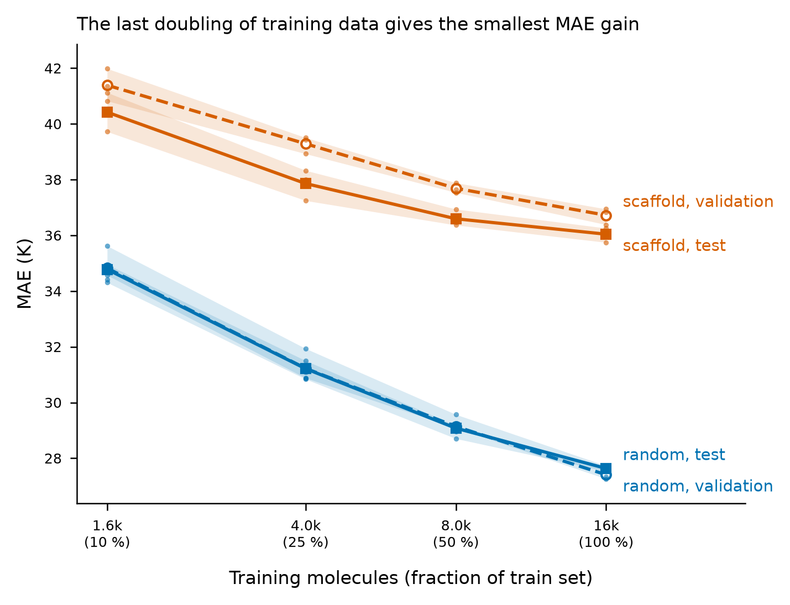
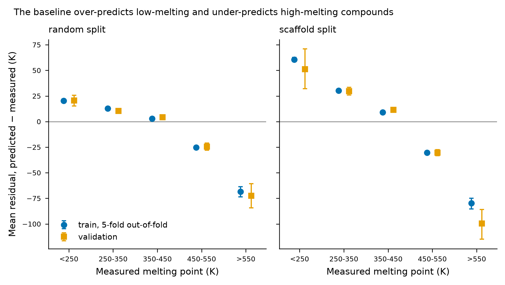
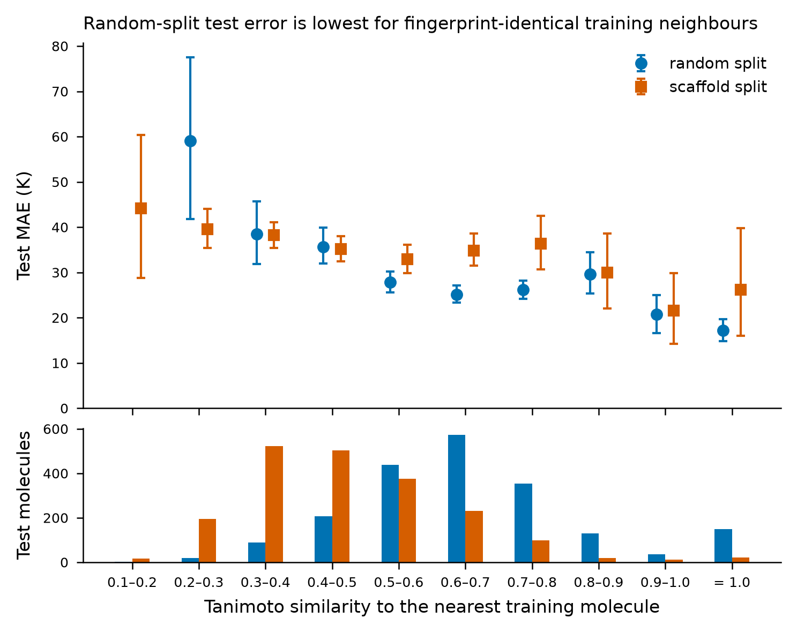

# 1단계 오차 분해 요약 (errdecomp 트랙)

- 데이터: Bradley Open MP `mp.csv` 19,945행, 단위 K. 분할: `splits/random.csv` (train 15,955 / validate 1,995 / test 1,995), `splits/scaffold.csv` (15,956 / 1,994 / 1,995), seed 42.
- 모델: 기준선 XGBoost (600그루, lr 0.05, depth 6, subsample 0.8, colsample 0.5) + RDKit 기술자 217개, train만 학습, **n_jobs=8 고정**, XGBoost 3.4.2. 이 트랙은 진단이며 튜닝하지 않았다.
- test 사용 범위: (a) 학습 곡선의 고정 test MAE, (b) 근접 중복이 기준선 test MAE에 주는 영향 — 두 곳뿐. 오차 구조(3절)는 train 5-fold out-of-fold(OOF) 예측과 validation 예측만 썼다.
- 비용 (ledger 29줄 합): wall 569 s, CPU 0.556 core-h, 추정 에너지 0.0021 kWh (CPU 사용률 × TDP 45 W 추정), 최대 RAM 0.94 GB. [ledger_errdecomp.csv](ledger_errdecomp.csv)

## 0. 계획과 다르게 한 것 · 한계

1. 반복측정 원자료(병합 전 27,976행)는 허가된 폴더(`C:\Users\mthog\CEPL ML`, 파일 507개 목록 확인)에 **없음** → 1절의 잡음 추정은 README 통계 3개에 분포를 가정해 맞춘 모형값이다(직접 계산 아님). Bradley figshare 원본은 이 트랙에서 내려받지 않았다.
2. 상위 오차 50개 목록은 '다른 분할의 test에 속한 분자'까지 뺐다(random OOF 상위 50 중 4개가 scaffold test 소속이라 제외하고 다음 순위로 채움). scaffold OOF 목록도 따로 저장했다.
3. scaffold OOF(GroupKFold)는 사슬형 3,074개가 한 fold로 통째로 빠진다(그 fold MAE 55.8 K). scaffold OOF의 계열·구간 수치는 '그 계열을 한 번도 못 본 모델'의 오차가 섞여 있어, scaffold 쪽 해석은 validation을 우선했다.
4. 오차 구조의 '전하 원자' 계열 정의: 나이트로기는 [N+](=O)[O-]로 적혀 전하 원자로 잡히므로 '나이트로 제외' 계열을 따로 두었다.
5. 계획에 없던 보조 분석을 더했다: 계열 겹침 보정 회귀, 대칭 × 크기 교차, OOF 오차 꼬리, 예측값 구간별 잔차, 학습 곡선의 포화형 외삽 모형.

## 1. 라벨 잡음 하한

**방법 한 줄**: 측정값 = 참값 + 독립 오차로 두고, 반복측정 4,679종(측정 12,710개, 화합물당 평균 2.716개)에서 범위 ≥ 10 K 410종(0.0876), ≥ 50 K 86종(0.0184)이 되도록 2모수 분포를 맞춘 뒤, 단일 측정 라벨(전체의 76.5 %)과 중앙값 병합 라벨(23.5 %)의 기대 |오차|를 가중 평균했다 (몬테카를로 seed 0).

| id | 가정 | 꼬리 비중 w | 꼬리 척도[K] (C는 t 자유도) | 단일 측정 E\|오차\| [K] | 중앙값 병합 E\|오차\| [K] | test MAE 하한 [K] | RMSE 하한 [K] | 독립 두 측정 E\|Δ\| [K] | 무잡음 test라면 기준선 MAE [K] (Laplace) | (정규) |
|---|---|---|---|---|---|---|---|---|---|---|
| A1 | 정규 2성분 혼합, 핵 SD 0.5 K 고정 | 0.043 | 35.00 | 1.58 | 0.86 | 1.41 | 6.59 | 2.86 | 27.03 | 27.08 |
| A2 | 정규 2성분 혼합, 핵 SD 1 K 고정 | 0.043 | 34.92 | 1.95 | 1.12 | 1.76 | 6.61 | 3.37 | 27.02 | 27.07 |
| A3 | 정규 2성분 혼합, 핵 SD 2 K 고정 (기준 가정) | 0.042 | 34.91 | 2.69 | 1.62 | 2.44 | 6.72 | 4.36 | 26.98 | 27.06 |
| A4 | 정규 2성분 혼합, 핵 SD 3 K 고정 | 0.021 | 48.69 | 3.17 | 1.99 | 2.89 | 7.02 | 4.90 | 26.98 | 27.05 |
| A5 | A3 + 반복 수 k 가 2 또는 3 | 0.041 | 34.97 | 2.69 | 1.46 | 2.40 | 6.64 | 4.36 | 26.99 | 27.06 |
| A6 | A3 + 반복 수 k = 2 + 기하분포 | 0.042 | 34.85 | 2.69 | 1.71 | 2.46 | 6.76 | 4.37 | 26.98 | 27.05 |
| B1 | 정규 핵(SD 2 K) + Laplace 꼬리 | 0.047 | 25.04 | 2.71 | 1.64 | 2.46 | 7.24 | 4.37 | 26.96 | 27.02 |
| C1 | Student-t (두꺼운 꼬리), \|오차\| <= 200 K 에서 자름 | – | 0.78 | 1.88 | 1.01 | 1.67 | 8.49 | 3.45 | 26.92 | 26.97 |
| C2 | Student-t (두꺼운 꼬리), \|오차\| <= 100 K 에서 자름 | – | 0.44 | 1.45 | 0.75 | 1.29 | 6.58 | 2.81 | 27.05 | 27.09 |
| D1 | A3 + 반복 세트의 25 % 는 같은 값을 옮겨 적은 사본(독립 아님) | 0.056 | 34.59 | 3.06 | 1.97 | 2.81 | 7.82 | 5.06 | 26.81 | 26.89 |
| D2 | A3 + 반복 세트의 50 % 는 사본 | 0.087 | 33.98 | 3.83 | 2.54 | 3.53 | 9.65 | 6.50 | 26.46 | 26.58 |
| D3 | A3 + 반복 세트의 75 % 는 사본 (극단 가정) | 0.194 | 32.06 | 6.26 | 5.13 | 5.99 | 13.85 | 10.83 | 25.26 | 25.51 |

- **test 라벨 잡음만으로 남는 MAE 하한: 1.3–3.5 K** (독립 가정 ~ 반복 세트의 절반이 사본이라는 가정까지, 시나리오 A1–D2). 반복 세트의 75 %가 사본이라는 극단 가정(D3)에서는 6.0 K. RMSE로는 6.6–9.6 K (D3 13.8 K).
- 민감도: 핵 SD(0.5 → 3 K)가 하한을 1.41 → 2.89 K로 움직이고, 반복 수 분포(A3/A5/A6)는 ±0.04 K 이내, 꼬리 모양(B1, C1, C2)은 1.29–2.46 K, 사본 비율(0 → 50 → 75 %)이 2.44 → 3.53 → 5.99 K로 가장 크게 움직인다.
- 기준선 27.50 K(random test, n=1,995) 중 test 라벨 잡음의 몫: 모델 오차와 라벨 오차가 독립이라고 보고 되돌리면 무잡음 test에서의 기준선 MAE는 26.5–27.1 K → **몫은 0.4–1.0 K** (D3 극단에서 2.0–2.2 K). MAE는 제곱합처럼 더해지지 않으므로 하한 값(1.3–3.5 K)을 27.50 K에서 그대로 뺄 수 없다.
- 데이터 안 직접 표본 (mp.csv, 19,945행 / InChIKey 전체 19,897종 / 첫 블록 19,381종):
  - InChIKey 전체가 같고 SMILES만 다른 행: 52쌍(45묶음), 평균 |Δ| 1.79 K (95 % CI 0.97–3.13), 중앙값 0.5 K, ≥ 10 K 1.9 %, ≥ 50 K 0 %. 독립 동분포 오차라면 라벨 하나의 E|오차|는 평균 |Δ|의 1/2 ~ 1배 = 0.9–1.8 K. 위 모형이 예측한 '독립 두 측정의 E|Δ|'(2.8–6.5 K, A1–D2)의 아래쪽 끝보다도 작다 — 표본이 작고(52쌍) 같은 출처를 옮겨 적은 항목일 수 있다.
  - 첫 블록만 같은 쌍(입체 이성질체 등): 638쌍(431묶음), 평균 |Δ| 13.2 K (CI 11.2–15.3), 중앙값 2.0 K, ≥ 10 K 29 %, ≥ 50 K 6.7 %. 이쪽은 부분입체 이성질체·E/Z·라세미체 대 단일 거울상처럼 **실제 물성 차이**가 섞여 있어 잡음 추정에 쓰면 안 된다(입체를 무시하고 합칠 때 생기는 손해의 상한으로만 읽는다).
- **한계**: (i) README 통계는 상류에서 `donotuse` 행을 지운 뒤의 값이고 반복 항목이 서로 독립인지 알 수 없어 과소추정 쪽으로 치우친다. (ii) 측정이 하나뿐인 76.5 %는 반복측정으로 검증되지 않는다 — 단일 항목의 큰 오류(예: 끓는점이 녹는점 칸에 들어간 경우)는 이 모형에 없다. 3절의 OOF 꼬리가 그 크기의 상한을 준다: random train OOF에서 |오차| ≥ 150 K인 86개(0.54 %)가 OOF MAE 27.80 K 중 1.00 K, ≥ 100 K인 344개가 2.89 K를 차지한다(전부가 라벨 오류는 아니다). (iii) 지시서가 인용한 문헌의 '실험 불확도 약 32–35 °C(RMSE)'와 여기서 나온 RMSE 하한 6.6–9.6 K의 차이는 이 자료만으로 설명되지 않는다 — Bradley 원본의 화합물별 측정 목록으로 직접 계산해야 확정된다.
- 표: [label_noise_floor.csv](tables/label_noise_floor.csv), [label_noise_indata.csv](tables/label_noise_indata.csv), [label_noise_indata_pairs.csv](tables/label_noise_indata_pairs.csv)

## 2. 고정 test 학습 곡선

**방법 한 줄**: 두 분할 각각 train의 10/25/50/100 %를 무작위 추출(부분집합 seed = XGB random_state = 0, 1, 2; 100 %는 모델 seed만 다름)해 기준선 설정으로 학습, 같은 validation·test에서 MAE 기록 (적합 24개).

| 분할 | train 비율 | n_train | seed 수 | val MAE 평균 [K] | val SD | test MAE 평균 [K] | test SD | 적합 시간 [s] |
|---|---|---|---|---|---|---|---|---|
| random | 0.10 | 1,596 | 3 | 34.82 | 0.22 | 34.78 | 0.73 | 5.7 |
| random | 0.25 | 3,989 | 3 | 31.22 | 0.32 | 31.21 | 0.62 | 6.6 |
| random | 0.50 | 7,978 | 3 | 29.14 | 0.04 | 29.08 | 0.44 | 8.0 |
| random | 1.00 | 15,955 | 3 | 27.41 | 0.19 | 27.63 | 0.10 | 11.8 |
| scaffold | 0.10 | 1,596 | 3 | 41.39 | 0.58 | 40.42 | 0.70 | 5.3 |
| scaffold | 0.25 | 3,989 | 3 | 39.29 | 0.31 | 37.86 | 0.56 | 7.0 |
| scaffold | 0.50 | 7,978 | 3 | 37.69 | 0.18 | 36.59 | 0.30 | 8.6 |
| scaffold | 1.00 | 15,956 | 3 | 36.72 | 0.30 | 36.04 | 0.27 | 9.8 |

구간별 2배당 변화(평균 기준):

| 분할 | 지표 | n 시작 | n 끝 | MAE 시작 [K] | MAE 끝 [K] | 2배당 변화 [K] |
|---|---|---|---|---|---|---|
| random | val_MAE | 1,596 | 3,989 | 34.82 | 31.22 | -2.72 |
| random | val_MAE | 3,989 | 7,978 | 31.22 | 29.14 | -2.08 |
| random | val_MAE | 7,978 | 15,955 | 29.14 | 27.41 | -1.73 |
| random | test_MAE | 1,596 | 3,989 | 34.78 | 31.21 | -2.70 |
| random | test_MAE | 3,989 | 7,978 | 31.21 | 29.08 | -2.14 |
| random | test_MAE | 7,978 | 15,955 | 29.08 | 27.63 | -1.44 |
| scaffold | val_MAE | 1,596 | 3,989 | 41.39 | 39.29 | -1.59 |
| scaffold | val_MAE | 3,989 | 7,978 | 39.29 | 37.69 | -1.60 |
| scaffold | val_MAE | 7,978 | 15,956 | 37.69 | 36.72 | -0.97 |
| scaffold | test_MAE | 1,596 | 3,989 | 40.42 | 37.86 | -1.94 |
| scaffold | test_MAE | 3,989 | 7,978 | 37.86 | 36.59 | -1.26 |
| scaffold | test_MAE | 7,978 | 15,956 | 36.59 | 36.04 | -0.55 |

MAE = a + b·log2(n) 적합 (b = 데이터 2배당 MAE 변화):

| 분할 | 지표 | 적합에 쓴 수준 | 관측 수 | b = 2배당 MAE 변화 [K] | 표준오차 | seed 부트스트랩 2.5 % | 97.5 % |
|---|---|---|---|---|---|---|---|
| random | val_MAE | all 4 fracs | 12 | -2.24 | 0.09 | -2.31 | -2.16 |
| random | val_MAE | upper 3 fracs (25-100 %) | 9 | -1.91 | 0.09 | -2.07 | -1.73 |
| random | val_MAE | last doubling (50->100 %) | 6 | -1.73 | 0.11 | -1.88 | -1.52 |
| random | test_MAE | all 4 fracs | 12 | -2.17 | 0.14 | -2.39 | -2.00 |
| random | test_MAE | upper 3 fracs (25-100 %) | 9 | -1.79 | 0.18 | -2.13 | -1.57 |
| random | test_MAE | last doubling (50->100 %) | 6 | -1.44 | 0.26 | -1.93 | -1.09 |
| scaffold | val_MAE | all 4 fracs | 12 | -1.43 | 0.09 | -1.60 | -1.26 |
| scaffold | val_MAE | upper 3 fracs (25-100 %) | 9 | -1.28 | 0.12 | -1.47 | -1.09 |
| scaffold | val_MAE | last doubling (50->100 %) | 6 | -0.97 | 0.20 | -1.31 | -0.66 |
| scaffold | test_MAE | all 4 fracs | 12 | -1.34 | 0.14 | -1.53 | -1.14 |
| scaffold | test_MAE | upper 3 fracs (25-100 %) | 9 | -0.91 | 0.17 | -1.17 | -0.64 |
| scaffold | test_MAE | last doubling (50->100 %) | 6 | -0.55 | 0.23 | -0.91 | -0.19 |

- **데이터 2배당 MAE 변화** (마지막 2배 50 → 100 %, ± 표준오차): random validation -1.73 ± 0.11 K / test -1.44 ± 0.26 K, scaffold validation -0.97 ± 0.20 K / test -0.55 ± 0.23 K. 4개 수준 전체 로그선형 적합은 random -2.24 ± 0.09 / -2.17 ± 0.14 K, scaffold -1.43 ± 0.09 / -1.34 ± 0.14 K.
- 기울기는 구간마다 줄어든다(random validation -2.72, -2.08, -1.73 K; scaffold test -1.94, -1.26, -0.55 K). 네 계열 모두 마지막 2배의 이득이 가장 작다 → 로그선형 외삽은 낙관적이다.
- scaffold의 기울기는 random의 56 % (validation, 마지막 2배) / 38 % (test).

외삽 (100 % 관측 평균에서 출발; M1 로그선형 전체 = 낙관, M2 로그선형 상위 3수준, M3 바닥 있는 거듭제곱, M4 기울기 감쇠 = 보수):

| 분할 | 지표 | train 배수 | M1 loglinear all [K] | M2 loglinear upper3 [K] | M3 powerlaw+floor [K] | M4 decaying slope [K] |
|---|---|---|---|---|---|---|
| random | test_MAE | x2 | 25.47 | 25.85 | 26.45 | 26.58 |
| random | test_MAE | x4 | 23.30 | 24.06 | 25.54 | 25.80 |
| random | test_MAE | x18.8 (n=300,000) | 18.45 | 20.06 | 24.21 | 24.74 |
| random | val_MAE | x2 | 25.17 | 25.50 | 26.03 | 26.03 |
| random | val_MAE | x4 | 22.94 | 23.59 | 24.91 | 24.92 |
| random | val_MAE | x18.8 (n=300,000) | 17.95 | 19.33 | 23.14 | 23.21 |
| scaffold | test_MAE | x2 | 34.71 | 35.13 | 35.62 | 35.74 |
| scaffold | test_MAE | x4 | 33.37 | 34.22 | 35.36 | 35.57 |
| scaffold | test_MAE | x18.8 (n=300,000) | 30.39 | 32.19 | 35.09 | 35.43 |
| scaffold | val_MAE | x2 | 35.29 | 35.44 | 35.76 | 35.94 |
| scaffold | val_MAE | x4 | 33.86 | 34.16 | 34.96 | 35.32 |
| scaffold | val_MAE | x18.8 (n=300,000) | 30.67 | 31.29 | 33.61 | 34.34 |

- validation 기준 기대 MAE 범위(M1–M4): random 2배 25.2–26.0 K, 4배 22.9–24.9 K, 약 19배(n = 300,000) 17.9–23.2 K (현재 27.4 K). scaffold 2배 35.3–35.9 K, 4배 33.9–35.3 K, 약 19배 30.7–34.3 K (현재 36.7 K).
- test 기준: random 2배 25.5–26.6 K, 4배 23.3–25.8 K, 약 19배 18.5–24.7 K (현재 27.6 K). scaffold 2배 34.7–35.7 K, 4배 33.4–35.6 K, 약 19배 30.4–35.4 K (현재 36.0 K).
- 가장 낙관적인 외삽으로도 30만 개에서 random 18 K 수준 → **데이터 양만으로 10 K에 닿지 않는다.**
- **외삽 한계**: (i) 같은 분포에서 뽑은 부분집합의 곡선이다 — 외부 데이터(OCHEM·특허)는 화학 공간과 라벨 품질이 달라 같은 n이라도 효과가 작을 수 있고, test·val과 겹치는 분자를 지우면 유효 n이 준다. (ii) 라벨 잡음 하한(1절) 근처에서 포화한다. (iii) scaffold test는 새 뼈대다 — 외부 데이터가 그 뼈대 근처를 채우지 않으면 효과가 작다(실제로 scaffold 기울기가 더 작다). (iv) 600그루 고정 설정의 곡선이라, 데이터가 늘 때 나무 수를 함께 늘리면 이득이 더 클 수 있다(이 트랙에서는 확인하지 않음). (v) seed 3개, 표의 SD는 부분집합 + 모델 seed 변동이며 test 표본 변동은 포함하지 않는다. M3·M4의 점근값은 자유도가 1뿐이라 구간이 매우 넓다.
- 표: [learning_curve.csv](tables/learning_curve.csv), [learning_curve_summary.csv](tables/learning_curve_summary.csv), [learning_curve_fit.csv](tables/learning_curve_fit.csv), [learning_curve_segments.csv](tables/learning_curve_segments.csv), [learning_curve_extrap.csv](tables/learning_curve_extrap.csv)

## 3. 오차 구조 (OOF + validation, test 미사용)

**방법 한 줄**: random train은 KFold(5, shuffle, random_state 42), scaffold train은 GroupKFold(5, Murcko 뼈대)로 기준선 OOF 예측(random_state 42)을 만들고, 제공된 validation 예측과 함께 구간·계열별로 집계했다. CI는 부트스트랩 2,000회(seed 0). OOF MAE: random 27.80 K (n=15,955), scaffold 37.18 K (n=15,956).

(i) 측정 MP 구간별:

| 분할 | 예측 출처 | MP 구간 [K] | n | MAE [K] | 평균 잔차 pred−y [K] | 95 % CI 하한 | 상한 | 전체 MAE 기여 [K] |
|---|---|---|---|---|---|---|---|---|
| random | oof_train | <250 | 1,417 | 27.77 | 20.43 | 18.65 | 22.02 | -0.00 |
| random | oof_train | 250-350 | 4,520 | 23.60 | 12.71 | 11.86 | 13.52 | -1.19 |
| random | oof_train | 350-450 | 6,489 | 25.51 | 2.90 | 2.05 | 3.70 | -0.93 |
| random | oof_train | 450-550 | 3,136 | 33.37 | -25.29 | -26.63 | -24.03 | 1.10 |
| random | oof_train | >550 | 393 | 69.32 | -68.46 | -73.56 | -63.64 | 1.02 |
| random | validation | <250 | 182 | 29.10 | 20.63 | 15.30 | 25.79 | 0.14 |
| random | validation | 250-350 | 532 | 21.36 | 10.42 | 8.08 | 12.58 | -1.67 |
| random | validation | 350-450 | 845 | 25.85 | 4.28 | 1.92 | 6.70 | -0.74 |
| random | validation | 450-550 | 378 | 32.59 | -24.38 | -27.95 | -21.05 | 0.94 |
| random | validation | >550 | 58 | 73.36 | -72.43 | -84.22 | -60.67 | 1.33 |
| scaffold | oof_train | <250 | 1,721 | 62.43 | 60.65 | 58.58 | 62.77 | 2.72 |
| scaffold | oof_train | 250-350 | 4,998 | 35.72 | 30.24 | 29.34 | 31.17 | -0.46 |
| scaffold | oof_train | 350-450 | 6,276 | 28.58 | 8.97 | 8.09 | 9.89 | -3.38 |
| scaffold | oof_train | 450-550 | 2,635 | 38.60 | -30.31 | -31.89 | -28.80 | 0.24 |
| scaffold | oof_train | >550 | 326 | 80.19 | -79.85 | -85.26 | -74.77 | 0.88 |
| scaffold | validation | <250 | 34 | 53.77 | 51.24 | 32.04 | 70.93 | 0.30 |
| scaffold | validation | 250-350 | 308 | 36.84 | 29.82 | 25.96 | 33.58 | 0.08 |
| scaffold | validation | 350-450 | 916 | 28.47 | 11.35 | 9.03 | 13.50 | -3.62 |
| scaffold | validation | 450-550 | 651 | 38.02 | -30.45 | -33.39 | -27.50 | 0.55 |
| scaffold | validation | >550 | 85 | 99.66 | -99.66 | -114.94 | -85.85 | 2.70 |

같은 잔차를 **예측값** 구간으로 나누면 (재보정 가능성 판단용):

| 분할 | 예측 출처 | 예측값 구간 [K] | n | 평균 잔차 pred−y [K] | 95 % CI 하한 | 상한 |
|---|---|---|---|---|---|---|
| random | oof_train | <250 | 1,241 | 0.44 | -1.79 | 2.59 |
| random | oof_train | 250-350 | 4,312 | 1.10 | 0.05 | 2.16 |
| random | oof_train | 350-450 | 7,222 | 0.22 | -0.63 | 1.11 |
| random | oof_train | 450-550 | 3,070 | -2.34 | -3.94 | -0.78 |
| random | oof_train | >550 | 110 | -6.26 | -16.55 | 3.62 |
| random | validation | <250 | 156 | 1.17 | -4.58 | 6.49 |
| random | validation | 250-350 | 541 | 1.43 | -1.47 | 4.39 |
| random | validation | 350-450 | 909 | 1.60 | -0.81 | 4.01 |
| random | validation | 450-550 | 365 | -6.54 | -10.76 | -2.24 |
| random | validation | >550 | 24 | -22.00 | -50.28 | 6.87 |
| scaffold | oof_train | <250 | 822 | 23.83 | 21.00 | 26.86 |
| scaffold | oof_train | 250-350 | 4,362 | 21.91 | 20.63 | 23.23 |
| scaffold | oof_train | 350-450 | 8,206 | 9.93 | 8.99 | 10.90 |
| scaffold | oof_train | 450-550 | 2,524 | 3.74 | 1.93 | 5.65 |
| scaffold | oof_train | >550 | 42 | -4.47 | -16.79 | 8.08 |
| scaffold | validation | <250 | 24 | -1.03 | -14.78 | 11.05 |
| scaffold | validation | 250-350 | 204 | -1.33 | -8.16 | 5.57 |
| scaffold | validation | 350-450 | 1,113 | -4.10 | -7.12 | -1.14 |
| scaffold | validation | 450-550 | 634 | -2.63 | -6.16 | 0.91 |
| scaffold | validation | >550 | 19 | -23.18 | -61.40 | 11.55 |

(ii) 무거운 원자 수 × MP 구간, random train OOF — 칸: MAE [K] (n):

| 무거운 원자 수 | <250 K | 250-350 K | 350-450 K | 450-550 K | >550 K | 전체 |
|---|---|---|---|---|---|---|
| <=10 | 25.8 (1,111) | 23.3 (1,496) | 31.5 (880) | 48.2 (214) | 69.2 (42) | 27.9 (3,743) |
| 11-20 | 31.5 (256) | 22.8 (2,629) | 23.8 (3,897) | 36.4 (1,515) | 73.6 (157) | 26.9 (8,454) |
| 21-30 | 47.7 (43) | 29.8 (323) | 25.9 (1,437) | 27.9 (1,130) | 66.5 (131) | 29.1 (3,064) |
| 31-45 | 89.7 (7) | 31.5 (58) | 28.9 (249) | 26.4 (250) | 61.9 (56) | 31.8 (620) |
| >45 | – | 41.6 (14) | 30.4 (26) | 40.8 (27) | 85.8 (7) | 41.6 (74) |
| all | 27.8 (1,417) | 23.6 (4,520) | 25.5 (6,489) | 33.4 (3,136) | 69.3 (393) | 27.8 (15,955) |

random validation:

| 무거운 원자 수 | <250 K | 250-350 K | 350-450 K | 450-550 K | >550 K | 전체 |
|---|---|---|---|---|---|---|
| <=10 | 24.8 (137) | 22.0 (171) | 30.7 (112) | 35.9 (23) | 89.2 (3) | 26.2 (446) |
| 11-20 | 41.4 (38) | 20.6 (320) | 25.1 (498) | 34.7 (179) | 73.8 (28) | 27.2 (1,063) |
| 21-30 | 39.1 (6) | 25.3 (40) | 24.0 (205) | 30.0 (141) | 59.0 (18) | 27.9 (410) |
| 31-45 | – | 17.8 (1) | 33.5 (29) | 30.3 (33) | 88.0 (8) | 37.9 (71) |
| >45 | 84.1 (1) | – | 17.0 (1) | 26.8 (2) | 155.9 (1) | 62.1 (5) |
| all | 29.1 (182) | 21.4 (532) | 25.8 (845) | 32.6 (378) | 73.4 (58) | 27.6 (1,995) |

(scaffold 분할과 평균 잔차는 [mae_heavy_x_mp.csv](tables/mae_heavy_x_mp.csv))

(iii) 계열별, random 분할 (기여 = 계열 n × (계열 MAE − 전체 MAE) / 전체 n; '겹침 보정' = |오차|를 계열 표지 13개 + 무거운 원자 구간에 회귀한 계수, 부트스트랩 500회 CI). 여러 조각('.' 포함) 분자는 데이터 전체에 1개뿐이고 random train·validation에 없어 표에서 빠졌다:

| 예측 출처 | 계열 | n | 계열 MAE [K] | 나머지 MAE [K] | 평균 잔차 [K] | 잔차 CI 하한 | 상한 | 전체 MAE 기여 [K] | 겹침 보정 추가 오차 [K] | 보정 CI 하한 | 보정 CI 상한 |
|---|---|---|---|---|---|---|---|---|---|---|---|
| oof_train | 2D 대칭 높음(고유 순위/무거운 원자 <= 0.5) | 1,648 | 36.25 | 26.82 | -2.04 | -4.45 | 0.32 | 0.87 | 9.36 | 7.70 | 11.19 |
| oof_train | 다환(고리 >= 3) | 3,628 | 31.17 | 26.80 | -0.40 | -1.75 | 0.91 | 0.77 | 3.78 | 2.40 | 5.23 |
| oof_train | 입체 가능한데 미표기(중심 또는 이중결합) | 4,082 | 29.73 | 27.13 | 0.52 | -0.77 | 1.82 | 0.49 | 2.03 | 0.75 | 3.35 |
| oof_train | 회전 가능 결합 0(강직) | 2,975 | 30.40 | 27.20 | -1.17 | -2.68 | 0.30 | 0.49 | 2.93 | 1.65 | 4.22 |
| oof_train | 이중결합 입체 가능한데 미표기 | 1,456 | 29.79 | 27.60 | -0.24 | -2.31 | 1.82 | 0.18 | 0.16 | -1.56 | 1.88 |
| oof_train | 수소결합 주개 >= 3 | 899 | 30.66 | 27.63 | -1.71 | -4.29 | 0.95 | 0.16 | 2.53 | 0.53 | 4.68 |
| oof_train | 할로젠 다량(>= 4개 또는 >= 30 %) | 1,063 | 29.17 | 27.70 | 0.82 | -1.78 | 3.30 | 0.09 | 0.62 | -1.30 | 2.37 |
| oof_train | 전하 원자 있음(나이트로 제외) | 130 | 38.82 | 27.71 | -2.90 | -11.06 | 5.75 | 0.09 | 10.13 | 5.09 | 16.40 |
| oof_train | 아마이드/우레아 | 2,412 | 27.82 | 27.79 | -0.42 | -2.01 | 1.04 | 0.00 | 0.79 | -0.44 | 1.92 |
| oof_train | 사슬형(고리 0) | 2,459 | 27.75 | 27.80 | 0.63 | -0.98 | 2.23 | -0.01 | -0.28 | -1.87 | 1.06 |
| oof_train | 입체 표기 있음(@ 또는 / \) | 1,049 | 27.50 | 27.82 | -1.12 | -3.34 | 1.19 | -0.02 | -0.30 | -1.82 | 1.63 |
| oof_train | 전하 원자 있음(나이트로 포함) | 1,457 | 27.44 | 27.83 | -0.64 | -2.49 | 1.12 | -0.03 | 0.23 | -1.09 | 1.58 |
| oof_train | 카복실산 | 1,919 | 25.96 | 28.05 | -0.41 | -1.92 | 1.23 | -0.22 | -0.14 | -1.22 | 1.16 |
| validation | 2D 대칭 높음(고유 순위/무거운 원자 <= 0.5) | 233 | 36.49 | 26.43 | -3.48 | -9.50 | 2.52 | 1.04 | 10.52 | 6.17 | 15.23 |
| validation | 다환(고리 >= 3) | 441 | 31.11 | 26.61 | -2.42 | -6.51 | 1.39 | 0.78 | 4.65 | 1.25 | 8.42 |
| validation | 수소결합 주개 >= 3 | 130 | 36.16 | 27.01 | -8.05 | -16.35 | 0.08 | 0.56 | 7.83 | 2.18 | 13.55 |
| validation | 아마이드/우레아 | 308 | 30.04 | 27.16 | -3.86 | -8.45 | 0.67 | 0.38 | 3.38 | -0.17 | 6.96 |
| validation | 입체 표기 있음(@ 또는 / \) | 135 | 31.29 | 27.34 | -2.44 | -9.73 | 4.92 | 0.25 | 1.77 | -2.76 | 7.12 |
| validation | 이중결합 입체 가능한데 미표기 | 180 | 29.87 | 27.38 | -0.46 | -6.14 | 5.21 | 0.20 | 2.88 | -2.14 | 7.30 |
| validation | 카복실산 | 212 | 29.50 | 27.38 | 3.93 | -0.92 | 8.83 | 0.20 | 2.86 | -0.96 | 5.97 |
| validation | 회전 가능 결합 0(강직) | 390 | 28.08 | 27.49 | -2.18 | -5.94 | 1.48 | 0.09 | 1.16 | -2.31 | 4.80 |
| validation | 전하 원자 있음(나이트로 제외) | 26 | 32.95 | 27.54 | -12.50 | -26.40 | 2.75 | 0.07 | 4.29 | -4.89 | 14.31 |
| validation | 입체 가능한데 미표기(중심 또는 이중결합) | 506 | 27.79 | 27.54 | 0.89 | -2.42 | 4.22 | 0.05 | -1.45 | -4.61 | 2.20 |
| validation | 할로젠 다량(>= 4개 또는 >= 30 %) | 155 | 27.99 | 27.57 | 0.37 | -5.50 | 5.88 | 0.03 | 0.26 | -3.84 | 4.38 |
| validation | 전하 원자 있음(나이트로 포함) | 195 | 27.84 | 27.58 | -4.62 | -9.83 | 0.48 | 0.02 | 1.05 | -2.85 | 5.28 |
| validation | 사슬형(고리 0) | 324 | 26.94 | 27.74 | 0.06 | -4.35 | 4.58 | -0.11 | -0.53 | -4.83 | 3.58 |

(iv) OOF |오차| 상위 50개(random train, 두 분할의 test 분자 제외) 중 앞 12개 — 전체는 [top50_oof_errors.csv](tables/top50_oof_errors.csv):

| 순위(거르기 전) | row | smiles | y [K] | OOF 예측 [K] | 잔차 [K] | 계열 표지 |
|---|---|---|---|---|---|---|
| 1 | 19,860 | ClC1(Cl)C2(Cl)C3(Cl)C4(Cl)C(Cl)(Cl)C5(Cl)C3(Cl)C1(Cl)C5(Cl)C24Cl | 758.15 | 485.3 | -272.8 | stereo_possible_unspecified;polycyclic_ge3;halogen_heavy;rigid_rotb0;sym2d_high |
| 2 | 15,653 | CCOP(=O)(OCC)Oc1ccc([N+](=O)[O-])cc1 | 573.15 | 302.6 | -270.6 | charged_any |
| 3 | 19,838 | CCCCCCCCCCCCS[C@H](C(=O)Nc1cc(C)c(O)c(C)c1C)c1ccccc1 | 128.90 | 385.7 | 256.8 | stereo_annotated;amide_urea |
| 4 | 15,610 | CC(C)F | 406.55 | 150.7 | -255.9 | acyclic;rigid_rotb0 |
| 5 | 15,547 | CC(C)=CCCC(C)CC(=O)O | 530.15 | 275.0 | -255.1 | stereo_possible_unspecified;acyclic;carboxylic_acid |
| 6 | 15,172 | CCN(CC)CCCl | 483.65 | 231.3 | -252.3 | acyclic |
| 7 | 14,922 | C=C(C)C(=O)OCCCCOC(=O)C(=C)C | 499.43 | 259.5 | -239.9 | acyclic;sym2d_high |
| 8 | 6,489 | CCC(=O)OCc1ccccc1 | 495.15 | 259.3 | -235.9 | (해당 없음) |
| 9 | 19,823 | COC(=O)C(NC(=O)COC(=O)CC1=CC(NC2=C(Cl)C=CC=CC2Cl)C=CC=C1)C(C)C | 790.15 | 554.8 | -235.3 | stereo_possible_unspecified;amide_urea |
| 10 | 11,948 | CCOC(=O)C(C#N)=Cc1ccc(N(C)C)cc1 | 584.15 | 351.7 | -232.4 | stereo_possible_unspecified;dblbond_stereo_unspecified |
| 11 | 9,830 | O=C(C=Cc1ccccc1F)c1ccccc1 | 588.15 | 357.5 | -230.6 | stereo_possible_unspecified;dblbond_stereo_unspecified |
| 12 | 16,703 | C=C(C)COC(=O)OCC(=C)C | 474.45 | 246.8 | -227.6 | acyclic |

**해석**

1. 평균 당김: random OOF에서 < 250 K 구간 +20.4 K (CI 18.7–22.0), 250–350 K +12.7 K, 450–550 K -25.3 K, > 550 K -68.5 K (CI -73.6 ~ -63.6, n=393). 450 K 이상 두 구간이 전체 MAE에 +1.10 K와 +1.02 K를 더한다. validation도 같은 크기다.
2. 그러나 **예측값** 구간으로 나누면 random OOF의 평균 잔차는 n ≥ 1,000인 구간에서 -2.3 ~ +1.1 K다. 즉 당김은 눈금이 틀어진 것이 아니라 특징이 고융점·저융점을 가려내지 못해 생기는 평균 회귀다 → 선형·isotonic 사후 재보정(T6)의 random 기대 이득은 0에 가깝고, 고융점을 가려낼 **정보**(T4 특징)가 필요하다.
3. 전체 MAE 기여가 큰 계열(random OOF): 2D 대칭 높음 +0.87 K (n=1,648, MAE 36.2 vs 나머지 26.8 K), 다환(고리 ≥ 3) +0.77 K (MAE 31.2 K), 강직(회전 결합 0) +0.49 K (MAE 30.4 K), 입체 가능·미표기 +0.49 K (MAE 29.7 K). 계열이 서로 겹치므로 기여는 더해지지 않는다.
4. 겹침을 보정해도 남는 추가 오차: 2D 대칭 높음 +9.4 K (CI 7.7–11.2; validation +10.5 K, CI 6.2–15.2), 전하(나이트로 제외, n=130) +10.1 K (CI 5.1–16.4), 다환 +3.8 K, 강직 +2.9 K, 수소결합 주개 ≥ 3 +2.5 K (validation +7.8 K). 대칭 계열의 추가 오차는 무거운 원자 구간마다 6.7–18.6 K로 유지된다(크기 효과가 아님, [mae_sym_x_size.csv](tables/mae_sym_x_size.csv)). 입체 가능·미표기는 OOF +2.0 K이지만 validation에서는 -1.5 K (CI -4.6 ~ 2.2)로 재현되지 않았다. 사슬형·카복실산·아마이드·입체 표기·할로젠 다량은 random에서 추가 오차의 CI가 0을 포함한다.
5. T4(물리·결정 특징)의 근거: 대칭(가장 크고 OOF·validation 모두에서 재현), 강직·다환, 수소결합 주개 수. T8-N2 템플릿 서술에 넣을 구조 항목: 대칭(동등 원자 묶음 비율·회전 대칭수), 고리 수와 접합 여부, 회전 가능 결합 수, 수소결합 주개/받개 수, 전하·쌍성이온·염 여부, 할로젠 수, 입체 표기(E/Z·중심) 유무.
6. 상위 50개: 44개가 과소예측, 사슬형 20개(전체 비율의 2.6배), 할로젠 다량 11개(3.3배), y > 550 K 11개(8.9배). 작고 수소결합 주개가 없는 할로젠화물·에스터에 400–500 K 라벨이 붙은 사례(예: row 15610 `CC(C)F` 406.55 K, row 7047 `CCOC(=O)C(CC)CC` 424.15 K, row 6489 `CCC(=O)OCc1ccccc1` 495.15 K)는 끓는점이나 염의 녹는점이 잘못 들어간 **라벨 오류로 의심**된다 — 구조만 보고 내린 판단이며 PubChem 등으로 확인하지 않았다(T5에서 확인 대상). 모델 예측을 쓰지 않는 규칙('사슬형·수소결합 주개 0·전하 없음·무거운 원자 ≤ 15인데 라벨 ≥ 400 K')에 걸리는 분자는 random train에 26개, OOF MAE 149 K, 전체 OOF MAE의 0.24 K다.

- 한계: 구간을 측정값으로 나누면 잡음만으로도 양 끝에서 당김이 생긴다(선택 효과). 2D 대칭 지표는 그래프 대칭이지 결정 대칭이 아니다. 계열 보정 회귀는 서술용이며 인과 효과가 아니다. scaffold OOF는 0절 3번의 fold 구조 영향을 받는다.
- 표: [resid_by_mp_bin.csv](tables/resid_by_mp_bin.csv), [mae_heavy_x_mp.csv](tables/mae_heavy_x_mp.csv), [mae_by_family.csv](tables/mae_by_family.csv), [family_adjusted_excess.csv](tables/family_adjusted_excess.csv), [mae_sym_x_size.csv](tables/mae_sym_x_size.csv), [top50_oof_errors.csv](tables/top50_oof_errors.csv), [top50_oof_errors_scaffold.csv](tables/top50_oof_errors_scaffold.csv), [top50_family_enrichment.csv](tables/top50_family_enrichment.csv), [oof_error_tail.csv](tables/oof_error_tail.csv). 예측: [oof_baseline_random_train.csv](preds/oof_baseline_random_train.csv), [oof_baseline_scaffold_train.csv](preds/oof_baseline_scaffold_train.csv). 분자별 계열 표지(19,945행): [mol_flags.csv](tables/mol_flags.csv)

## 4. 근접 중복

**방법 한 줄**: 분할 파일의 InChIKey(전체 / 첫 블록 14자)와 Morgan 지문(반경 2, 2,048 bit, 입체 무시; BulkTanimotoSimilarity)으로 세트 간 겹침을 세고, 겹치는 test 분자를 뺐을 때 저장된 기준선 예측의 MAE 변화를 계산했다(모델 재적합 없음; CI는 test 부트스트랩 2,000회).

| 분할 | 세트 A | 세트 B | 기준 | A의 분자 수 | A 중 B와 겹치는 분자 수 | 쌍 수 |
|---|---|---|---|---|---|---|
| random | test | train | InChIKey 전체 | 1,995 | 8 | 8 |
| random | test | train | InChIKey 첫 블록(입체 무시) | 1,995 | 92 | 119 |
| random | test | train | Morgan(r2, 2048 bit) Tanimoto = 1.0 | 1,995 | 148 | 543 |
| random | test | train | Tanimoto = 1.0 이지만 첫 블록은 다름(지문 충돌) | 1,995 | 65 | – |
| random | validate | train | InChIKey 전체 | 1,995 | 6 | 7 |
| random | validate | train | InChIKey 첫 블록(입체 무시) | 1,995 | 73 | 101 |
| random | validate | train | Morgan(r2, 2048 bit) Tanimoto = 1.0 | 1,995 | 141 | 551 |
| random | validate | train | Tanimoto = 1.0 이지만 첫 블록은 다름(지문 충돌) | 1,995 | 77 | – |
| random | test | validate | InChIKey 전체 | 1,995 | 0 | 0 |
| random | test | validate | InChIKey 첫 블록(입체 무시) | 1,995 | 14 | 14 |
| random | test | validate | Morgan(r2, 2048 bit) Tanimoto = 1.0 | 1,995 | 53 | 73 |
| random | test | validate | Tanimoto = 1.0 이지만 첫 블록은 다름(지문 충돌) | 1,995 | 40 | – |
| scaffold | test | train | InChIKey 전체 | 1,995 | 5 | 5 |
| scaffold | test | train | InChIKey 첫 블록(입체 무시) | 1,995 | 6 | 6 |
| scaffold | test | train | Morgan(r2, 2048 bit) Tanimoto = 1.0 | 1,995 | 21 | 46 |
| scaffold | test | train | Tanimoto = 1.0 이지만 첫 블록은 다름(지문 충돌) | 1,995 | 21 | – |
| scaffold | validate | train | InChIKey 전체 | 1,994 | 7 | 8 |
| scaffold | validate | train | InChIKey 첫 블록(입체 무시) | 1,994 | 8 | 9 |
| scaffold | validate | train | Morgan(r2, 2048 bit) Tanimoto = 1.0 | 1,994 | 15 | 36 |
| scaffold | validate | train | Tanimoto = 1.0 이지만 첫 블록은 다름(지문 충돌) | 1,994 | 15 | – |
| scaffold | test | validate | InChIKey 전체 | 1,995 | 6 | 6 |
| scaffold | test | validate | InChIKey 첫 블록(입체 무시) | 1,995 | 6 | 6 |
| scaffold | test | validate | Morgan(r2, 2048 bit) Tanimoto = 1.0 | 1,995 | 25 | 46 |
| scaffold | test | validate | Tanimoto = 1.0 이지만 첫 블록은 다름(지문 충돌) | 1,995 | 25 | – |

**9절 누설 감사 1번(세트 간 InChIKey 전체·첫 블록 겹침 0) 판정: 두 분할 모두 불성립.**

- random: test 1,995개 중 첫 블록이 train 또는 validate에 있는 분자 **99개** (train과 92, validate와 14; InChIKey 전체는 train과 8, validate와 0). scaffold: **11개** (train과 6, validate와 6; 전체 키는 train 5, validate 6 — 호변 이성질체 등 SMILES가 달라 Murcko 뼈대가 달라진 경우).
- 겹치는 test row 목록: [overlap_test_rows_random.csv](tables/overlap_test_rows_random.csv) (166행 = 첫 블록 겹침 99 + Tanimoto 1.0만 겹침 67; `overlap_block1_train_or_val` 열이 감사 1번 기준), [overlap_test_rows_scaffold.csv](tables/overlap_test_rows_scaffold.csv) (47행, 그중 감사 1번 기준 11). test 자체는 바꾸지 않았고, 이후 '중복 제거 test' 보조 지표에 쓴다.
- Tanimoto 1.0 쌍에는 같은 분자가 아닌 지문 충돌(사슬 길이만 다른 동족체 등)이 섞여 있다: random test–train 148개 중 65개는 첫 블록이 다르다.

영향 (겹치는 분자만의 MAE / 뺀 나머지의 MAE):

| 분할 | 예측 | 겹침 기준 (test 분자) | 겹치는 n | 겹치는 분자 MAE [K] | 나머지 n | 나머지 MAE [K] | 전체 MAE [K] | 나머지 − 전체 [K] | 95 % CI 하한 | 상한 |
|---|---|---|---|---|---|---|---|---|---|---|
| random | refit_njobs8 | InChIKey 전체가 train 에 있음 | 8 | 34.01 | 1,987 | 27.61 | 27.63 | -0.03 | -0.09 | 0.03 |
| random | refit_njobs8 | 첫 블록이 train 에 있음 | 92 | 20.89 | 1,903 | 27.96 | 27.63 | 0.33 | 0.14 | 0.51 |
| random | refit_njobs8 | Tanimoto 1.0 인 train 분자 있음 | 148 | 17.17 | 1,847 | 28.47 | 27.63 | 0.84 | 0.60 | 1.08 |
| random | refit_njobs8 | 위 셋 중 하나(train) | 157 | 18.40 | 1,838 | 28.42 | 27.63 | 0.79 | 0.54 | 1.04 |
| random | refit_njobs8 | 첫 블록이 train 또는 validate 에 있음 (9절 감사 1번 기준) | 99 | 21.76 | 1,896 | 27.94 | 27.63 | 0.31 | 0.10 | 0.51 |
| random | refit_njobs8 | 첫 블록 또는 Tanimoto 1.0 (train 또는 validate) | 166 | 18.57 | 1,829 | 28.46 | 27.63 | 0.82 | 0.57 | 1.08 |
| random | orig_27.50 | InChIKey 전체가 train 에 있음 | 8 | 36.41 | 1,987 | 27.46 | 27.50 | -0.04 | -0.11 | 0.02 |
| random | orig_27.50 | 첫 블록이 train 에 있음 | 92 | 21.09 | 1,903 | 27.81 | 27.50 | 0.31 | 0.12 | 0.50 |
| random | orig_27.50 | Tanimoto 1.0 인 train 분자 있음 | 148 | 17.06 | 1,847 | 28.34 | 27.50 | 0.84 | 0.60 | 1.08 |
| random | orig_27.50 | 위 셋 중 하나(train) | 157 | 18.45 | 1,838 | 28.27 | 27.50 | 0.77 | 0.53 | 1.02 |
| random | orig_27.50 | 첫 블록이 train 또는 validate 에 있음 (9절 감사 1번 기준) | 99 | 21.94 | 1,896 | 27.79 | 27.50 | 0.29 | 0.09 | 0.49 |
| random | orig_27.50 | 첫 블록 또는 Tanimoto 1.0 (train 또는 validate) | 166 | 18.60 | 1,829 | 28.31 | 27.50 | 0.81 | 0.56 | 1.07 |
| scaffold | refit_njobs8 | InChIKey 전체가 train 에 있음 | 5 | 23.77 | 1,990 | 35.88 | 35.85 | 0.03 | 0.00 | 0.07 |
| scaffold | refit_njobs8 | 첫 블록이 train 에 있음 | 6 | 25.24 | 1,989 | 35.88 | 35.85 | 0.03 | 0.00 | 0.07 |
| scaffold | refit_njobs8 | Tanimoto 1.0 인 train 분자 있음 | 21 | 26.14 | 1,974 | 35.96 | 35.85 | 0.10 | -0.03 | 0.22 |
| scaffold | refit_njobs8 | 위 셋 중 하나(train) | 27 | 25.94 | 1,968 | 35.99 | 35.85 | 0.14 | -0.00 | 0.26 |
| scaffold | refit_njobs8 | 첫 블록이 train 또는 validate 에 있음 (9절 감사 1번 기준) | 11 | 40.41 | 1,984 | 35.83 | 35.85 | -0.03 | -0.15 | 0.06 |
| scaffold | refit_njobs8 | 첫 블록 또는 Tanimoto 1.0 (train 또는 validate) | 47 | 39.63 | 1,948 | 35.76 | 35.85 | -0.09 | -0.40 | 0.16 |

- random test, 9절 기준(99개 제거): 원본 기준선 27.50 → **27.79 K** (+0.29 K, CI +0.09 ~ +0.49), n_jobs=8 재적합 27.63 → 27.94 K (+0.31 K, CI +0.10 ~ +0.51). Tanimoto 1.0까지 빼면(166개) 원본 28.31 K (+0.81 K), 재적합 28.46 K (+0.82 K).
- scaffold test: 9절 기준(11개) 35.85 → 35.83 K (-0.03 K, CI -0.15 ~ +0.06); Tanimoto 1.0 포함(47개) -0.09 K (CI가 0 포함).
- 기준선은 쌍둥이를 '외우지' 못한다: 첫 블록이 train에 있는 random test 92개에서 기준선 MAE는 20.9 K인데, train 쌍둥이의 라벨을 그대로 쓰면 11.4 K다. 이 조회만으로 random test 전체 MAE가 약 0.44 K 내려가지만, 이는 근접 중복을 이용한 이득이므로 '중복 제거 test'에서 따로 봐야 한다.

입체 미표기·같은 첫 블록 쌍:

| 항목 (전체 19,945행) | 수 |
|---|---|
| 이중결합 입체 가능한데 미표기 | 1,821 |
| 입체 중심 가능한데 미표기 | 3,530 |
| 입체 가능한데 미표기(중심 또는 이중결합) | 5,121 |
| 입체 표기 있음 | 1,330 |
| InChIKey 전체 고유 수 | 19,897 |
| InChIKey 첫 블록 고유 수 | 19,381 |
| 첫 블록을 다른 행과 공유하는 행 수 | 1,036 |

| 쌍의 종류 | 쌍 수 | 평균 \|Δ\| [K] | 중앙값 [K] | 90 % 분위 [K] | ≥ 10 K 비율 | ≥ 50 K 비율 |
|---|---|---|---|---|---|---|
| InChIKey 전체 동일(SMILES 만 다름) | 52 | 1.79 | 0.50 | 3.99 | 0.019 | 0.000 |
| 둘 다 미표기(동위원소·양성자화 등 다른 층) | 24 | 4.82 | 1.00 | 3.46 | 0.042 | 0.042 |
| 둘 다 표기 — E/Z 만 다름 | 11 | 34.04 | 4.00 | 152.07 | 0.455 | 0.182 |
| 둘 다 표기 — 입체 중심 포함 | 181 | 18.34 | 3.00 | 46.50 | 0.398 | 0.094 |
| 한쪽만 입체 표기(표기 vs 미표기) | 345 | 10.31 | 1.50 | 31.48 | 0.258 | 0.049 |
| 한쪽만 입체 표기(표기 vs 미표기) — E/Z | 77 | 13.36 | 2.00 | 34.00 | 0.247 | 0.078 |
| 같은 첫 블록 전체 | 690 | 12.30 | 2.00 | 34.38 | 0.271 | 0.062 |

- 이중결합 입체가 가능한데 표기 없는 분자는 1,821개다. 'E/Z만 다른, 둘 다 표기된 쌍'은 11쌍뿐이지만 평균 |Δ| 34.0 K로 가장 크다 → cis/trans가 미표기로 합쳐졌다면 그 정도의 라벨 불확실성이 숨어 있을 수 있으나, 이 데이터만으로는 어느 분자가 합쳐졌는지 알 수 없다.

최근접 train 유사도 구간별 MAE (n_jobs=8 재적합 예측; 칸: MAE [K] (n)):

| 최근접 train Tanimoto | random test MAE [K] (n) | random validate MAE [K] (n) | scaffold test MAE [K] (n) | scaffold validate MAE [K] (n) |
|---|---|---|---|---|
| 0.0-0.1 | – | – | – | – |
| 0.1-0.2 | 87.0 (3) | 69.4 (1) | 44.1 (17) | 32.9 (11) |
| 0.2-0.3 | 59.0 (19) | 45.8 (23) | 39.6 (194) | 47.6 (169) |
| 0.3-0.4 | 38.5 (89) | 36.4 (103) | 38.2 (522) | 41.1 (450) |
| 0.4-0.5 | 35.7 (206) | 31.0 (218) | 35.2 (503) | 34.6 (556) |
| 0.5-0.6 | 27.8 (438) | 29.2 (473) | 33.0 (376) | 32.2 (401) |
| 0.6-0.7 | 25.1 (574) | 27.8 (546) | 34.9 (232) | 33.7 (251) |
| 0.7-0.8 | 26.1 (353) | 24.8 (337) | 36.4 (98) | 30.0 (100) |
| 0.8-0.9 | 29.6 (130) | 24.5 (118) | 29.9 (20) | 35.1 (32) |
| 0.9-1.0 | 20.8 (35) | 25.3 (35) | 21.5 (12) | 37.6 (9) |
| 1.0 | 17.2 (148) | 16.5 (141) | 26.1 (21) | 34.5 (15) |

- random test는 유사도 0.2–0.3 구간 59.0 K에서 1.0 구간 17.2 K까지 내려가고, scaffold test는 0.3–0.8 구간에서 33–38 K로 평평하다(유사도 0.5 미만이 1,236개 / 1,995).
- 표: [near_duplicates.csv](tables/near_duplicates.csv), [near_dup_block1_pairs.csv](tables/near_dup_block1_pairs.csv), [near_dup_effect.csv](tables/near_dup_effect.csv), [test_nn_similarity_mae.csv](tables/test_nn_similarity_mae.csv)

## 5. 2단계 가설에 주는 함의 (요약)

1. 라벨 잡음: 반복측정 통계로 본 test 잡음의 몫은 0.4–1.0 K로 작다. 다만 단일 항목의 큰 오류가 OOF 꼬리에 보인다 → T5는 '반복측정 충돌'보다 '구조상 불가능한 라벨'(규칙 기반)과 교차검증 잔차로 찾은 후보의 외부 확인이 더 값질 수 있다. 원본 반복측정으로 1절을 직접 검증할 것.
2. 데이터 양(T5 외부 데이터, T7-D4): 2배당 random -1.7 ~ -2.2 K, scaffold -1.0 ~ -1.4 K (validation). 외부 데이터 실험의 실패 기준으로 쓸 수 있다.
3. 평균 당김은 재보정으로 풀리지 않는다(예측값 구간 잔차 ≈ 0) → T6 재보정의 기대 효과는 0 근처, T4의 대칭·강직 특징과 T7-D7(극단 구간)은 validation으로 따로 검증.
4. 대칭 계열이 가장 큰 단일 오차원이다(겹침 보정 +9.4 K, 전체 기여 +0.87 K). T4·T8-N2/M2의 첫 후보.
5. 모든 최종 평가에 '중복 제거 test'(random 99개, scaffold 11개 제외) 보조 지표를 함께 보고한다. 기준선의 중복 제거 값: random 원본 27.79 K / 재적합 27.94 K (n=1,896), scaffold 35.83 K (n=1,984).

## 스크립트

[s1_label_noise.py](scripts/s1_label_noise.py) · [s2_learning_curve.py](scripts/s2_learning_curve.py) · [s2b_lc_extrap.py](scripts/s2b_lc_extrap.py) · [s3_error_structure.py](scripts/s3_error_structure.py) · [s3b_family_adjusted.py](scripts/s3b_family_adjusted.py) · [s4_near_duplicates.py](scripts/s4_near_duplicates.py) — 실행: `& .\mp_mae_push\common\run_mlstudy.ps1 mp_mae_push\phase1\scripts\<이름>.py` (s2b는 s2 뒤, s3b·s4는 s3 뒤).
